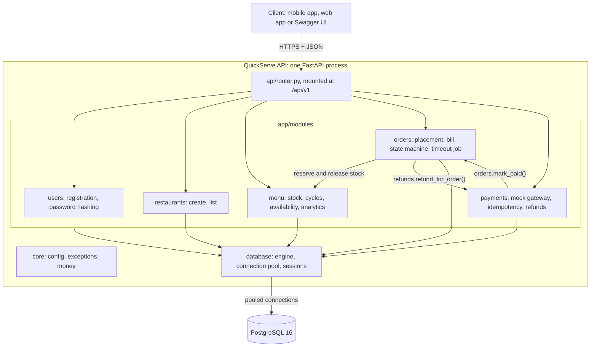
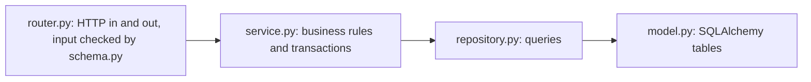
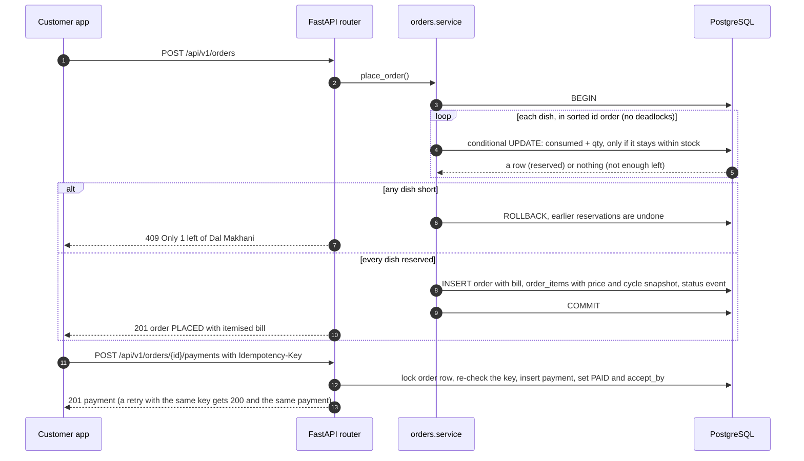
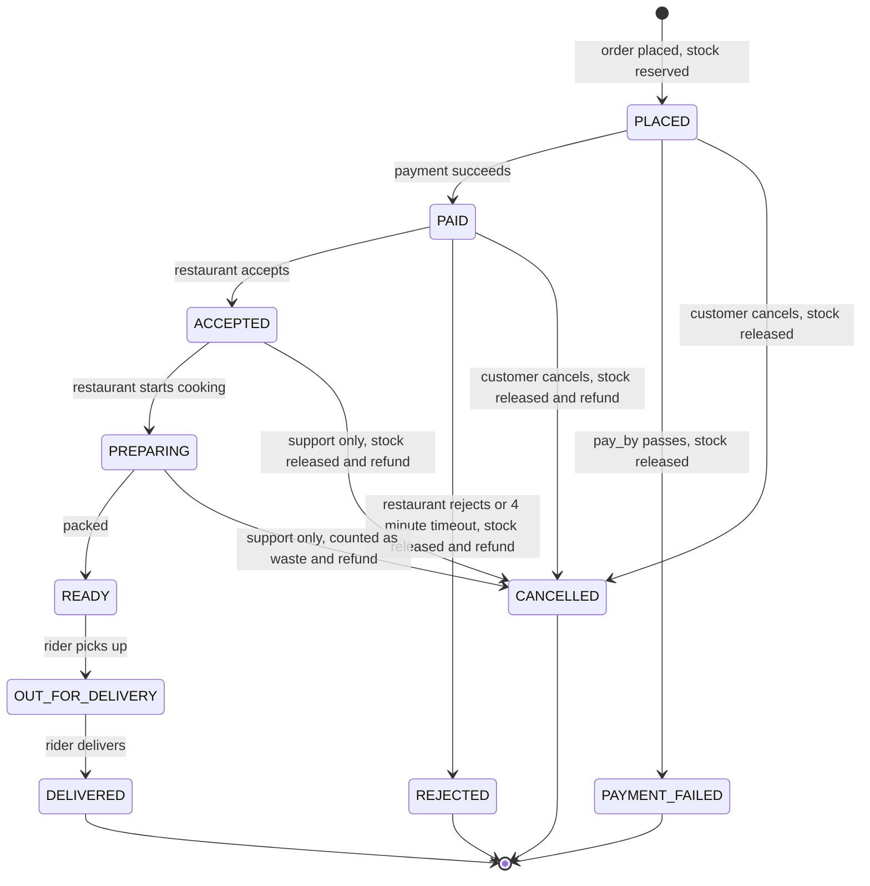
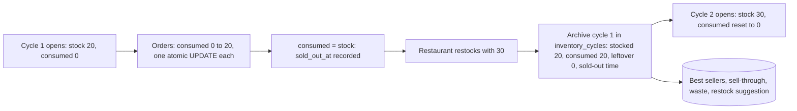
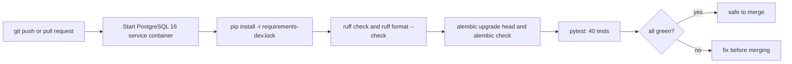
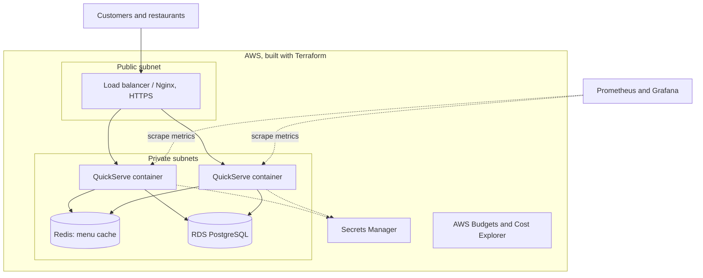

# QuickServe

[](https://github.com/revant123/quickserve/actions/workflows/ci.yml)

A cloud-native food ordering and delivery platform built using Python, FastAPI, SQLAlchemy, and PostgreSQL. Developed with a modular monolith architecture, gradually incorporating Docker, CI/CD, AWS, Kubernetes, Terraform, monitoring, and FinOps practices.

It is built to learn three things properly:

1. **How an ORM works**: what SQLAlchemy writes for you, what it hides, and where you still need SQL.
2. **DevOps**: migrations, real-database tests, CI, health checks, connection pools, and later Docker, AWS, Terraform and Kubernetes.
3. **FinOps**: measuring what each order costs to serve, and spotting waste before it becomes a bill.

The business logic is modelled on how Zomato and Swiggy behave: restaurants must accept orders within a time limit, items can be switched off "until 6 pm", every bill is itemised with fees and GST, and payments are safe to retry. The centrepiece is the **stock / consumed / cycle** inventory design, which makes best sellers, sell-through, waste tracking and restock suggestions possible.

**Stack:** Python 3.11+, FastAPI, SQLAlchemy 2.x (2.0-style API, pinned at 2.1.9), PostgreSQL 16, Alembic, pytest, GitHub Actions. **40 tests**, all run against a real PostgreSQL, including concurrency tests with real threads.

---

## Contents

1. [Run it (step by step)](#1-run-it-step-by-step)
2. [What it does: the requirements checklist](#2-what-it-does-the-requirements-checklist)
3. [Architecture](#3-architecture)
4. [The inventory design: stock, consumed and cycles](#4-the-inventory-design-stock-consumed-and-cycles)
5. [ORM vs writing SQL by hand](#5-orm-vs-writing-sql-by-hand)
6. [Business rules borrowed from Zomato and Swiggy](#6-business-rules-borrowed-from-zomato-and-swiggy)
7. [DevOps already in the project](#7-devops-already-in-the-project)
8. [FinOps: thinking in cost per order](#8-finops-thinking-in-cost-per-order)
9. [Bugs the tests caught while building this](#9-bugs-the-tests-caught-while-building-this)
10. [Project structure and API](#10-project-structure-and-api)
11. [Roadmap](#11-roadmap)
12. [Interview cheat sheet](#12-interview-cheat-sheet)
13. [References](#13-references)

---

## 1. Run it (step by step)

**You need:** Python 3.11 or newer, Git, and either **Docker Desktop** (easiest) or **PostgreSQL 16** installed on your machine.

### Step 1: Get the code

```bash
git clone https://github.com/revant123/quickserve.git
cd quickserve
```

### Step 2: Start PostgreSQL

**Option A: with Docker (recommended)**

```bash
docker compose up -d       # starts PostgreSQL 16; on first start it also creates quickserve and quickserve_test
docker compose ps          # wait until STATUS shows "healthy" and PORTS shows 0.0.0.0:5434->5432/tcp
```

QuickServe's database listens on port **5434** on your machine, not the usual 5432. That way it runs at the same time as QuickKart, whose databases already use 5432 and 5433.

**Ports used on the machine:**

| Project | Ports |
|---|---|
| QuickKart | 5432 (database), 5433 (test database), 8080, 1025, 8025 |
| QuickServe | 5434 (database), 8000 (API) |

**Option B: without Docker.** Install PostgreSQL 16, make sure user `postgres` has password `postgres`, then create the two databases. Your own PostgreSQL normally listens on 5432, so in step 4 change the port in `DATABASE_URL` from `5434` to `5432`.

```bash
psql -U postgres -c "CREATE DATABASE quickserve;"
psql -U postgres -c "CREATE DATABASE quickserve_test;"
```

### Step 3: Create a virtual environment and install dependencies

```bash
python -m venv venv                 # on Mac/Linux you may need: python3 -m venv venv
source venv/bin/activate            # Windows PowerShell: venv\Scripts\Activate.ps1
                                    # Windows cmd:        venv\Scripts\activate.bat
pip install -r requirements-dev.txt
```

### Step 4: Create your `.env`

```bash
cp .env.example .env                # Windows: copy .env.example .env
```

### Step 5: Create the tables (run the migrations)

```bash
alembic upgrade head
```

### Step 6: Load demo data

```bash
python -m scripts.seed
```

This prints a `customer_id`, two `restaurant_id`s and every `menu_item_id`. Keep them; you'll paste them into Swagger.

### Step 7: Start the API

```bash
uvicorn app.main:app --reload
```

### Step 8: Check it works

| Open or run | You should see |
|---|---|
| http://127.0.0.1:8000/health/ready | `{"status":"ready","database":"ok"}` |
| http://127.0.0.1:8000/docs | Swagger UI with every endpoint |
| `pytest -q` (in a second terminal, venv active) | `40 passed` |

### Step 9: Place your first order in Swagger

Use the IDs that `seed` printed:

1. `GET /api/v1/restaurants/{restaurant_id}/menu`: the customer menu with `orderable` and badges.
2. `POST /api/v1/orders` with your `customer_id`, `restaurant_id` and an item. The response has the itemised bill.
3. `POST /api/v1/orders/{order_id}/payments` with header `Idempotency-Key: my-first-payment`. Send it again with the same key: you get `200` and `Idempotent-Replayed: true`, not a second charge.
4. `PATCH /api/v1/orders/{order_id}/status` with `{"status": "ACCEPTED", "actor": "restaurant"}`.
5. `GET /api/v1/orders/{order_id}/timeline`: every status change, who made it and when.
6. `POST /api/v1/menu/{menu_item_id}/restock` with `{"quantity": 40}`. The response shows the archived cycle and `consumed` reset to 0.
7. `GET /api/v1/restaurants/{restaurant_id}/best-sellers`.
8. `GET /api/v1/menu/{menu_item_id}/restock-suggestion`.

### Other useful commands

```bash
python -m scripts.race_demo        # watch a naive stock counter oversell, next to the atomic one
python -m scripts.show_sql         # print the SQL the ORM generates for our key queries
ruff check . && ruff format --check .
alembic upgrade head --sql         # print a migration's SQL without running it
docker compose down                # stop PostgreSQL (add -v to also delete its data)
```

Set `SQL_ECHO=true` in `.env` and restart uvicorn to see every SQL statement in the terminal. It's the fastest way to learn what the ORM is doing.

### If something goes wrong

| Error | Fix |
|---|---|
| `Connection refused` on port 5434 | PostgreSQL isn't running. `docker compose ps`, or start your local PostgreSQL service (and set port 5432 in `.env`) |
| `password authentication failed` | The user or password in `DATABASE_URL` (in `.env`) doesn't match your PostgreSQL |
| `password authentication failed for user "postgres"` | The app is reaching a different PostgreSQL than QuickServe's. Check that `.env` uses port **5434** (copy `.env.example` again if you made `.env` earlier) and that `docker compose ps` shows `0.0.0.0:5434->5432/tcp` |
| `port is already allocated` (Docker) | Something else already uses 5434. Pick a free port, e.g. `"5435:5432"` in `docker-compose.yml`, and the same number in `.env` |
| `database "quickserve_test" does not exist` | The Docker init script runs only on the very first start. Run `docker compose exec db psql -U postgres -c "CREATE DATABASE quickserve_test;"` |
| `ModuleNotFoundError: No module named 'app'` | Run commands from the repository root with the venv activated |
| PowerShell won't run `Activate.ps1` | `Set-ExecutionPolicy -Scope CurrentUser RemoteSigned`, then try again |
| Tests say `Refusing to run tests against database ...` | Safety guard: tests empty their database, so they only run on a database whose name ends in `_test`. Unset any `DATABASE_URL` you exported in your shell |

---

## 2. What it does: the requirements checklist

| Requirement | Where it lives |
|---|---|
| Focus on how the ORM compares with writing SQL by hand | [Section 5](#5-orm-vs-writing-sql-by-hand); `app/modules/menu/analytics.py` (same report in ORM and raw SQL, tested equal); `scripts/show_sql.py`; `scripts/race_demo.py`; `tests/test_orm_behaviour.py` |
| DevOps and FinOps as the top priority | [Section 7](#7-devops-already-in-the-project) and [Section 8](#8-finops-thinking-in-cost-per-order); `.github/workflows/ci.yml`; `docker-compose.yml`; health checks; connection pool settings; lock file |
| Real business logic from Zomato / Swiggy | [Section 6](#6-business-rules-borrowed-from-zomato-and-swiggy): accept timeout, out-of-stock-until, itemised bill with platform fee and GST, cancellation rules, idempotent payments |
| Stock + consumer logic instead of QuickKart's `stock - 1` | [Section 4](#4-the-inventory-design-stock-consumed-and-cycles); `app/modules/menu/model.py` |
| Restock resets the consumer counter to zero | `restock()` in `app/modules/menu/service.py`, which archives the cycle first so no data is lost |
| Use it to find and showcase the best seller | `GET /restaurants/{id}/best-sellers`; ranking explained in Section 4 |
| Any other benefits of this design | The 11-point list in Section 4: sell-through, sold-out time, waste, badges, restock suggestion, audit trail and more |
| Everything in the README, as natural questions and answers | This file |

**What's built so far, and what isn't:**

| Area | Done | Not yet |
|---|---|---|
| Users | Registration with Argon2 password hashing via pwdlib, as FastAPI's docs now recommend [4] (passlib stopped working on Python 3.13 [23]); unique emails enforced by the database | Login, JWT tokens, role checks (next task) |
| Restaurants | Create, list with pagination, packaging charge | Opening hours, delivery radius |
| Menu and stock | Stock/consumed counters, stock cycles with archive, restock with or without carry-over, "out of stock until" timer, customer badges ("Only 3 left", "Selling fast") | Add-ons and variants (half/full plate) |
| Orders | All-or-nothing placement, itemised bill, price snapshots, status machine with actor rules, cancellation rules, full timeline | Rider assignment, ETA |
| Payments | Mock gateway, idempotency keys, one-success-per-order rule, refunds on rejection/cancellation | Real gateway, webhooks |
| Background jobs | Expire unpaid orders, auto-reject orders the restaurant didn't accept (`FOR UPDATE SKIP LOCKED`) | A scheduler (today you trigger it via an endpoint) |
| Analytics | Best sellers ranked by sales rate while in stock, sell-through, restock suggestion that corrects for sold-out cycles | Revenue reports, dashboards |
| DevOps | Alembic migrations (tested up and down), PostgreSQL in Docker Compose, CI pipeline, liveness/readiness checks, pinned and locked dependencies | Dockerfile for the app, AWS, Terraform, Kubernetes |

Auth isn't built yet, so for now order requests carry a `customer_id` and status changes carry an `actor`. The admin job endpoint is unprotected. Both get fixed in the next task.

---

## 3. Architecture

### 3.1 The big picture: a modular monolith

One FastAPI application, one deployment, one PostgreSQL database, but split into **modules** with clear boundaries. Modules call each other only through small public functions, never by reaching into each other's tables. That keeps today's code simple, and it's what will let us lift a module (notifications, payments) out into its own service later without rewriting its callers.



### 3.2 Inside every module: four layers



| Layer | Knows about | Never does |
|---|---|---|
| `router.py` | HTTP, status codes, request/response schemas | Business decisions |
| `schema.py` | Pydantic validation, what the API accepts and returns | Touch the database |
| `service.py` | Business rules, transactions, calling other modules | Raise `HTTPException` (so the same code works from a job or a script) |
| `repository.py` | SQL and ORM queries, locks | Business decisions |
| `model.py` | Tables, columns, constraints, relationships | Anything else |

### 3.3 Data model

```mermaid
erDiagram
    USERS ||--o{ RESTAURANTS : owns
    USERS ||--o{ ORDERS : places
    RESTAURANTS ||--o{ MENU_ITEMS : offers
    RESTAURANTS ||--o{ ORDERS : receives
    MENU_ITEMS ||--o{ INVENTORY_CYCLES : "has history"
    MENU_ITEMS ||--o{ ORDER_ITEMS : "sold as"
    ORDERS ||--|{ ORDER_ITEMS : contains
    ORDERS ||--o{ ORDER_STATUS_EVENTS : "timeline"
    ORDERS ||--o{ PAYMENTS : "attempts"

    USERS {
        uuid id PK
        string email UK
        string password_hash
        enum role
    }
    RESTAURANTS {
        uuid id PK
        uuid owner_id FK
        numeric packaging_charge
        bool is_open
    }
    MENU_ITEMS {
        uuid id PK
        uuid restaurant_id FK
        numeric price
        bool is_available
        timestamptz unavailable_until
        bool track_stock
        int stock
        int consumed
        int cycle_no
        timestamptz sold_out_at
    }
    INVENTORY_CYCLES {
        uuid id PK
        uuid menu_item_id FK
        int cycle_no
        int units_stocked
        int units_consumed
        int units_returned
        int units_wasted
        int leftover
        timestamptz started_at
        timestamptz sold_out_at
        timestamptz closed_at
    }
    ORDERS {
        uuid id PK
        uuid customer_id FK
        uuid restaurant_id FK
        enum status
        numeric grand_total
        timestamptz pay_by
        timestamptz accept_by
    }
    ORDER_ITEMS {
        uuid id PK
        uuid order_id FK
        uuid menu_item_id FK
        numeric unit_price
        int quantity
        int cycle_no
    }
    PAYMENTS {
        uuid id PK
        uuid order_id FK
        enum status
        string idempotency_key UK
    }
    ORDER_STATUS_EVENTS {
        uuid id PK
        uuid order_id FK
        enum from_status
        enum to_status
        string actor
    }
```



Rules the **database itself** enforces, so a bug in Python can't break them:

| Constraint | Rule |
|---|---|
| `ck_menu_items_stock_consistent` | `consumed <= stock` for tracked items; `stock` is NULL for untracked ones |
| `uq_inventory_cycles_one_open` (partial unique index) | At most one open stock cycle per item |
| `uq_payments_one_success_per_order` (partial unique index) | At most one successful payment per order |
| `uq_payments_idempotency_key` | A retried payment can't create a second charge |
| `uq_users_email` | No duplicate accounts, even with simultaneous sign-ups |
| `ck_order_items_quantity_positive`, `ck_menu_items_price_positive` | No zero/negative quantities or prices |

### 3.4 What happens when a customer places and pays for an order



### 3.5 Order lifecycle



### 3.6 The stock cycle



### 3.7 CI pipeline (runs on every push and pull request)



### 3.8 Where it's heading (planned, Phases 4 to 7)



Only PostgreSQL is in Docker today; everything in this last diagram is the plan for the phases in the [roadmap](#11-roadmap).

---

## 4. The inventory design: stock, consumed and cycles

### Q: In QuickKart we did `stock -= 1` on every sale and stopped at 0. What's wrong with that?

It works for "can I sell one more?", but it throws away information:

- After a few sales you can't tell how many were prepared. `stock = 4` could mean "made 5, sold 1" or "made 50, sold 46".
- When you restock, you overwrite the number, and that cycle's sales are gone.
- So you can't compute a best seller fairly, can't measure waste, and can't learn how much to prepare tomorrow.

It also has a concurrency trap if the code reads the stock into Python, subtracts, and writes it back. That trap is covered further down.

### Q: So what does QuickServe do instead?

It keeps two numbers per item, which is your "consumer and stock" idea. In code the counter is called `consumed` because it counts units consumed:

```
stock      = units prepared for the current cycle   (fixed during the cycle)
consumed   = units ordered so far in this cycle     (goes up with each order)
available  = stock - consumed                       (computed, never stored)
```

A **cycle** runs from one restock to the next. Restocking closes the current cycle, starts a new one, sets the new stock and resets `consumed` to 0:

```
   cycle 1 (stock = 20)                          cycle 2 (stock = 30)
 |-------------------------------------------| |------------------------- ...
 restock   consumed: 0 -> 5 -> 12 -> 20      restock   consumed: 0 -> 4 -> ...
 09:00                          ^ 13:10      18:00
                           sold_out_at       |
                                             +-- cycle 1 archived in inventory_cycles:
                                                 stocked 20, consumed 20, leftover 0,
                                                 sold out at 13:10, closed at 18:00
```

### Q: If consumed is reset to 0, isn't the sales history deleted?

It would be, and that's the one change needed to make your idea work. **Before resetting, the restock archives the closing cycle** into an `inventory_cycles` table: units stocked, units consumed, leftover, whether the leftover was carried forward, when it sold out, and when the cycle opened and closed. The live counter on `menu_items` stays small and fast for ordering; the history lives in its own table for analytics.

This is the classic split between **operational data** (the hot row every order touches) and **historical data** (append-only rows reports read).

### Q: What do we gain from this? The full list

1. **Fair best sellers.** Ranking by units sold rewards whatever you prepare most of. QuickServe ranks by *units sold per hour while the item was actually on sale* (more below).
2. **Sell-through rate** = units sold / units stocked. It's a standard retail metric: units sold divided by units received [5]. Retail guides treat about 75% or more as strong [6]. For food it reads directly: 40% means too much was cooked; 100% by lunchtime means too little.
3. **Sold-out time.** `sold_out_at` records the first moment a cycle hit zero. Sold out at 1 pm and sold out at 9 pm are very different signals that a plain counter can't tell apart.
4. **Restock suggestions that understand stock-outs.** When an item sells out, sales show only that demand was *at least* that much. Forecasting literature calls this **censored demand**: stock-outs cut off the sales you can observe, and models trained on that cut-off data underestimate demand, which leads to more stock-outs and more waste [7][9]. Estimating demand straight from sales is biased even when stock-outs are rare [8]. The suggestion endpoint corrects for this.
5. **Waste tracking.** Each cycle records the `leftover` at close and `units_wasted` (orders cancelled after cooking started). Multiply by food cost and you have the money lost to waste.
6. **Customer badges.** "Only 4 left" comes from `available`. "Selling fast" comes from the cycle's sales rate: at the current pace, will it sell out within the hour?
7. **An audit trail.** "On 17 Nov we made 20 biryanis, sold 18, 1 order was cancelled after the restock, 1 was cancelled while cooking." Each part of that sentence is a column.
8. **Made-to-order items still count.** A plain dosa might not be counted (`track_stock = false`, `stock = NULL`), but `consumed` still goes up, so it still appears in best-seller reports.
9. **Carry-over for packaged goods.** Cooked food is usually discarded at close, while a sealed lassi can roll into the next cycle. `carry_over_leftover` handles both, and the cycle records which happened.
10. **Correct cancellations across restocks.** Every order line remembers the `cycle_no` it was sold from (next question).
11. **A database-level guarantee.** A `CHECK (consumed <= stock)` constraint means PostgreSQL itself refuses an oversold value, even if a future bug slips through the code.

### Q: An order is placed, then the restaurant restocks, then the customer cancels. What happens to the stock?

This is the subtle case. If cancelling did `consumed -= 3` on the new cycle, it would hand out 3 phantom units that were never prepared in this cycle.

So each `order_items` row stores `cycle_no`, and releasing stock is a conditional update:

```sql
UPDATE menu_items SET consumed = consumed - 3
 WHERE id = :item AND cycle_no = :cycle_the_order_came_from AND consumed >= 3
RETURNING id
```

- **Same cycle:** the row matches and the 3 units go back on sale.
- **Item restocked since:** zero rows match. The service records the 3 units as `units_returned` on the *archived* cycle and leaves the new cycle untouched.

Test: `test_cancel_after_restock_credits_the_old_cycle`.

### Q: And a cancellation after cooking started?

The food exists but can't be resold, so the units are **not** released. They're counted as `units_wasted` on their cycle, and the customer is refunded. Customers can cancel only before the restaurant accepts; after that only support can.

### Q: Forty customers want the last ten biryanis at the same moment. What stops overselling?

One **conditional UPDATE** that checks and writes in the same statement:

```sql
UPDATE menu_items
   SET consumed = consumed + 1
 WHERE id = :item
   AND (NOT track_stock OR consumed + 1 <= stock)
RETURNING id, name, price, cycle_no
```

If it returns a row, the unit is reserved; if it returns nothing, the item can't cover the order. Two orders racing for the last unit can't both win. In PostgreSQL's default Read Committed level, the second UPDATE waits for the first to commit. It then **re-evaluates its WHERE clause against the updated row** and proceeds only if the row still matches [1]. It no longer matches, so it gets no row back.

You can watch the difference yourself with `python -m scripts.race_demo`. On the machine that built this project, both runs went like this every time:

```
NAIVE : 40 orders accepted for 10 biryanis | consumed counter says  3
        oversold by 30; the counter missed 37 sales (lost updates)
ATOMIC: 10 orders accepted for 10 biryanis | consumed counter says 10
```

The naive version reads `consumed` into Python, checks it, and writes `consumed + 1` back. Forty requests all read a small number, all pass the check, and overwrite each other's writes. Notice that the `CHECK (consumed <= stock)` constraint **didn't stop it**: every write stored a small, valid-looking number. It was just the wrong number. Constraints catch impossible values; only atomic updates or locks prevent **lost updates**.

Tests: `test_forty_customers_ten_biryanis`, plus the demo script.

### Q: What if a restock happens in the middle of a lunch rush?

Restocking has to read `consumed`, archive it and reset it, with no order sneaking in between. If one did, its sale would land in a cycle that had already been archived, or vanish. So restock takes a **row lock** first:

```sql
SELECT ... FROM menu_items WHERE id = :item FOR UPDATE
```

Orders for that item wait a few milliseconds and then land cleanly in the new cycle. The test fires 29 orders and 1 restock at the same instant, then checks that every unit sold is counted in exactly one cycle, and that the per-cycle totals match the `cycle_no` stored on each order line.

Test: `test_restock_in_the_middle_of_a_rush_loses_nothing`.

### Q: An order has paneer and naan, another has naan and paneer. Can they deadlock?

They could. If order A locks paneer then waits for naan, while order B locks naan then waits for paneer, each waits for the other forever. PostgreSQL detects this and kills one of them, which means a failed order. QuickServe **always reserves items in sorted ID order**, so two orders can never hold each other's next lock. It's a one-line fix that's easy to forget, and a common interview question.

### Q: Why rank best sellers by rate instead of units sold?

Take the numbers from `test_best_seller_is_ranked_by_rate_not_raw_volume`:

| | Prepared | Sold | On sale for | Units sold | Rate while available |
|---|---|---|---|---|---|
| Samosa | 200 | 120 | 10 h (never sold out) | **120** | about 11.7 per hour |
| Chicken Biryani | 20 | 20 | 1 h (then sold out) | 20 | **16 per hour** |

(Both items were then restocked, and the new, still-empty cycle counts for its 15-minute minimum: 120 / 10.25 h and 20 / 1.25 h. The test asserts these exact figures.)

By units sold, samosa "wins". But biryani ran out after an hour; after that nobody *could* buy it. Counting those empty hours would punish it for being popular. So for a sold-out cycle the clock stops at `sold_out_at`. Each cycle counts for at least 15 minutes, so one very early sell-out can't produce an absurd rate. Biryani ranks first. Sell-through is reported alongside the rate, because it says whether you prepared the right amount.

Platforms do tag best sellers. One published implementation tags items above the 97th percentile of order volume within a restaurant [18]. That's a volume rule; the rate-while-available rule here is the correction for stock-outs that the cycle data makes possible.

### Q: How does the restock suggestion work?

`GET /api/v1/menu/{id}/restock-suggestion` looks at the last 3 closed cycles:

- **Didn't sell out:** demand ≈ units sold.
- **Sold out:** sales are censored, so demand is estimated from the selling rate stretched over the whole cycle, capped at 2× sales. Example: 20 sold in the first 4 hours of an 8-hour cycle gives an estimate of about 40.
- The suggestion is the average of those estimates, rounded up, with an explanation for each cycle.

This is a deliberately simple teaching heuristic, not a production forecaster. Real systems use statistical models built for censored data [9]. The point is that **without archived cycles and `sold_out_at` you couldn't even begin**, because a plain stock counter has no way to tell "sold 20 because 20 people wanted it" from "sold 20 because we only made 20".

---

## 5. ORM vs writing SQL by hand

### Q: Is the ORM better than writing SQL queries manually?

For most of an application, yes. But "better" doesn't mean "you can forget SQL". The race demo above makes the point: **the ORM can generate both the wrong SQL and the right SQL, and only knowing SQL tells you which one you wrote.**

```python
# Python arithmetic on a value read earlier -> sends a literal: SET consumed = 4
item.consumed = item.consumed + 1

# A column expression -> sends SET consumed = consumed + 1 (atomic, done inside PostgreSQL)
update(MenuItem).values(consumed=MenuItem.consumed + 1)
```

Both look almost identical in Python. The first loses updates under concurrency; the second doesn't.

### Q: What does the ORM give us in this project? Concrete examples

| ORM feature | Where it's used | What you'd do by hand |
|---|---|---|
| **Unit of work**: you change objects, the session works out the INSERT/UPDATE order and runs them in one transaction | `place_order` creates an order, its items and a status event, all committed together | Order every statement yourself, manage `BEGIN`/`COMMIT`/`ROLLBACK` |
| **Relationships and loading strategies** | `selectinload(Restaurant.menu_items)` loads 3 restaurants and 9 dishes in exactly 2 queries (tested) | Write the join or the `IN (...)` query and stitch results into objects |
| **`lazy="raise"`** | Accessing `restaurant.menu_items` without asking for it raises an error instead of quietly running one query per restaurant (the N+1 problem) | No equivalent safety net |
| **Hybrid methods**: one rule, two worlds | `MenuItem.switched_on_at(now)` runs as Python on the menu page and becomes a SQL `WHERE` inside the order UPDATE, so they can never disagree | Write the rule twice and hope they stay in sync |
| **Column defaults and `onupdate`** | `updated_at` is set on every UPDATE automatically. `scripts/show_sql.py` shows the ORM adding `updated_at=now()` to the reservation UPDATE | Remember it in every UPDATE you write |
| **Bound parameters** | Every value is sent separately from the SQL text | Easy to slip into string formatting, the classic SQL-injection hole |
| **Migrations from models** | `alembic revision --autogenerate` wrote the first migration from the model classes; `alembic check` in CI fails if models and migrations drift apart | Write and maintain every `CREATE`/`ALTER` by hand |
| **Typed results** | `Mapped[Decimal]` columns come back as `Decimal`, `Mapped[OrderStatus]` as an enum | Convert types from raw rows yourself |

### Q: Where is raw SQL as good, or better?

- **Reports.** The best-seller report is written twice in `app/modules/menu/analytics.py`: once with SQLAlchemy (a CTE, `GROUP BY`, `RANK() OVER`) and once as plain SQL. A test proves they return identical rows. Be honest about it: for a report like this, many people find the SQL version easier to read. SQLAlchemy can express it, but the expression API is a second language. A reasonable rule: **ORM for business logic, raw SQL (or SQLAlchemy Core) for analytics.**
- **Bulk work.** Loading 100,000 rows as Python objects is slow; a single `INSERT ... SELECT` or `COPY` is far faster.
- **Database-specific features.** Partial indexes, `SKIP LOCKED` and `CHECK` constraints are all used here. SQLAlchemy supports them, but you still have to know they exist, which is a SQL skill.

### Q: What does the ORM hide that can bite you?

Three things, all demonstrated in `tests/test_orm_behaviour.py`:

1. **Hidden queries (N+1).** Default lazy loading turns a loop over 50 restaurants into 51 queries. We set `lazy="raise"` so that mistake fails in development.
2. **The identity map can serve stale data.** Within one session, each row is one Python object. If you hold an object and the row changes underneath you (another request, a script), **selecting it again returns the same object with the old values**. SQLAlchemy doesn't overwrite already-loaded objects unless you ask with `populate_existing`, `refresh()` or `expire()` [2]. This is especially dangerous with `SELECT ... FOR UPDATE`: you lock the row but read stale values, a known pitfall [3]. Every locking query in QuickServe uses `populate_existing=True` for this reason. (One of our own tests once passed by accident because of this; see section 9.)
3. **Autogenerate is a draft, not the truth.** Alembic's generated migration created PostgreSQL ENUM types in `upgrade()` but didn't drop them in `downgrade()`, so downgrade-then-upgrade failed with "type already exists". The fix was added by hand, and the test suite now runs downgrade and upgrade on every run. Always read a generated migration before committing it.

### Q: How do I see the SQL the ORM generates?

- `python -m scripts.show_sql` prints the compiled SQL for the reservation UPDATE, the restock lock, `selectinload`, and the best-seller report, without needing a database.
- `SQL_ECHO=true` in `.env` logs every statement the running app sends.
- `alembic upgrade head --sql` prints migration SQL instead of running it.

---

## 6. Business rules borrowed from Zomato and Swiggy

### Q: What happens if a restaurant never responds to an order?

On Zomato, according to a POS integrator's documentation, orders not reviewed within 4 minutes are auto-rejected, and that can't be disabled [15]. QuickServe does the same:

- On payment, the order gets `accept_by = paid_at + 240 seconds` (configurable).
- A background job finds `PAID` orders past `accept_by`, moves them to `REJECTED`, releases their stock and refunds the payment.
- The job claims rows with `FOR UPDATE SKIP LOCKED`, so several job workers can run side by side without processing the same order twice.
- If the restaurant taps Accept at the same instant the job fires, they meet at the order's row lock. If the restaurant gets it first, the job skips that row (`SKIP LOCKED`) and won't pick it up again, because it's no longer `PAID`. If the job gets it first, the restaurant's request waits, then sees `REJECTED` and fails the transition check. Either way there's never a "rejected and accepted" order.

The same job expires orders that were never paid (`pay_by`, 10 minutes by default) and gives their reserved stock back. This is the standard **reservation with a time limit** pattern: stock is held for you, but not forever.

### Q: How do restaurants mark a dish unavailable?

Swiggy's partner guide tells restaurants to proactively mark unavailable items as "Out of Stock" in the Inventory section until they're next available [16]. A sold-out dish left live on the apps costs a cancelled order, a refund and a lower rating [17], which is the whole reason stock tracking matters.

QuickServe supports three states through `PATCH /menu/{id}/availability`:

| `is_available` | `unavailable_until` | Meaning |
|---|---|---|
| true | null | On |
| false | 18:00 today | Off, and back on by itself at 18:00 |
| false | null | Off until someone switches it on |

The rule is a hybrid method, so the menu page and the order UPDATE apply exactly the same logic.

### Q: How is the bill calculated?

Like the itemised bills on delivery apps:

```
item total            250.00     sum of unit price x quantity (2 x Rs 125)
packaging charge       20.00     set by the restaurant
delivery fee           30.00     waived above Rs 299
platform fee           12.00     flat, per order
GST on food (5%)       13.50     on items + packaging
GST on fees (18%)       7.56     on delivery + platform fee
-------------------------------
grand total           333.06
```

Where the rules come from:

- **Platform fee.** A fixed per-order charge. In March 2026 Zomato raised it to Rs 14.90 before GST [10], and Swiggy raised its fee to Rs 17.58 including GST [11]. Both platforms change it often.
- **GST on food.** For orders through delivery apps, the e-commerce operator collects and deposits GST on the restaurant service under Section 9(5), at 5% without input tax credit [12].
- **GST on the platform's own fees.** Delivery charges billed by the operator, and platform fees, are a separate supply taxed at 18% [13]. Tax treatment of delivery keeps changing: a notification making operators liable for certain delivery services under Section 9(5) took effect on 1 November 2026 [14].

That is exactly why every fee and rate lives in `.env` / `Settings` and not in code: a fee change is a config change, not a redeploy. The defaults are illustrative and none of this is tax advice. The **whole bill is stored on the order**, so if the fee changes tomorrow, yesterday's receipts don't.

### Q: If a restaurant changes a price, do old orders change?

No. Each order line stores `item_name` and `unit_price` as **snapshots**. Test: `test_price_snapshot_survives_menu_price_change`.

### Q: Who can change an order's status, and when?

The lifecycle is data in `state_machine.py`, not scattered `if` statements:

```
PLACED --pay--> PAID --accept--> ACCEPTED --> PREPARING --> READY --> OUT_FOR_DELIVERY --> DELIVERED
  |              |                  |             |
  |              +--reject/timeout--+--> REJECTED  |
  +--timeout--> PAYMENT_FAILED      |             |
  +--cancel---> CANCELLED <---------+-------------+   (after ACCEPTED: support only)

Failed ending before PREPARING  -> stock released, payment refunded if one was taken
Failed ending from PREPARING    -> stock counted as waste, payment refunded
```

Each target status also lists who may set it: only the restaurant accepts, only a rider delivers, only the system marks an order paid. `DELIVERED -> PREPARING` is impossible because `DELIVERED` allows no next state. Every change is written to `order_status_events`, which powers the timeline endpoint today and notifications later.

### Q: The customer taps "Pay", the network drops, the app retries. Are they charged twice?

No. The client sends an `Idempotency-Key` header. A `UNIQUE` constraint on that key means a retry returns the first result (`200`, `Idempotent-Replayed: true`) instead of creating a second charge. A partial unique index enforces **at most one successful payment per order** in the database itself:

```sql
CREATE UNIQUE INDEX uq_payments_one_success_per_order ON payments (order_id) WHERE status = 'SUCCESS';
```

Failed attempts are kept, and the customer can retry with a new key until `pay_by`. A concurrency test found a real bug here; see section 9.

---

## 7. DevOps already in the project

### Q: Why do the tests use a real PostgreSQL instead of SQLite?

Because the features that make this app correct (row locks, `SKIP LOCKED`, partial unique indexes, `RETURNING`, CHECK constraints under concurrency, Read Committed re-checks) either don't exist in SQLite or behave differently there. A test that passes on SQLite would prove nothing about production. The test suite builds its database **by running the real Alembic migrations**, down and up, so every test run also tests the migrations.

### Q: Why is only the database in Docker right now?

Docker Compose runs PostgreSQL 16, the same major version as CI and, later, AWS RDS. The app runs on your machine with `--reload` for fast edit-and-retry while learning. Phase 5 adds a Dockerfile and an `api` service. The Compose file already shows two production habits: a **healthcheck** (`pg_isready`), so dependants wait until the DB is truly ready, and **resource limits**, which on a laptop protect your machine and in the cloud are what you pay for.

### Q: What does the CI pipeline do, and why each step?

`.github/workflows/ci.yml` runs on every push and pull request:

| Step | Why |
|---|---|
| PostgreSQL 16 **service container** | Tests run against the same database as production |
| Install from `requirements-dev.lock` | Exact versions of every package, including dependencies of dependencies (next question) |
| `ruff check` and `ruff format --check` | Style arguments end; obvious bugs (unused imports, shadowed names) caught before review |
| `alembic upgrade head` + `alembic check` | **Fails if someone changed a model but forgot to create a migration**, a very common production incident |
| `pytest` | All 40 tests, including the concurrency tests |
| `concurrency: cancel-in-progress` | Two quick pushes cancel the older run instead of paying for both |
| `timeout-minutes: 10` | A hung job can't burn CI minutes forever |

### Q: Why both `requirements-dev.txt` and `requirements-dev.lock`?

`requirements*.txt` pins the packages we chose. But those packages have their own dependencies, which aren't pinned. This bit us while building the project: a fresh install pulled a newer `starlette` (1.10.0, where another environment had 1.7.0), and the tests started printing a deprecation warning about the HTTP test client. The `.lock` file is `pip freeze` from an environment where all 40 tests passed on Python 3.11: every package at an exact version. CI and, later, the Docker image install from the lock, so a new release of some sub-dependency can't break a build overnight. You regenerate the lock on purpose, when you upgrade.

### Q: What's the difference between `/health` and `/health/ready`?

- **Liveness** (`/health`): is the process alive? Kubernetes **restarts** the container if this fails. It deliberately doesn't touch the database: if the DB goes down, restarting every healthy app container in a loop makes things worse.
- **Readiness** (`/health/ready`): can this instance serve traffic right now? It runs `SELECT 1`. If it fails, the load balancer **stops sending requests** to this instance, but nothing gets restarted.

Mixing the two up is a classic cause of cascading outages.

### Q: What is connection pooling, and why does it matter for cost?

Opening a PostgreSQL connection costs a network round trip, authentication and a new server process. The SQLAlchemy engine keeps a **pool** of open connections (`pool_size=5`, plus up to `max_overflow=10` under bursts) and lends one to each request. `pool_pre_ping` detects connections that the database or a firewall silently dropped.

The trap comes at deploy time. PostgreSQL allows 100 connections by default. Each app process has its own pool:

```
4 uvicorn workers x (5 + 10) connections x 3 replicas = 180 possible connections  >  100
```

Scale out under load and new requests start failing to connect. You can fix it with smaller pools, a connection pooler such as PgBouncer, or a bigger database. A bigger database **just to hold idle connections** is money spent on nothing. That's where DevOps and FinOps meet: a config line becomes a monthly bill.

### Q: Why does the code use the database's clock (`now()`) instead of Python's?

With several app servers, each machine's clock drifts a little. Deadlines like `pay_by` and `accept_by`, and timestamps like `sold_out_at`, all come from one source of truth, PostgreSQL, so comparisons between them are always consistent.

### Q: How are settings and secrets handled?

All configuration comes from environment variables or `.env`, read by `pydantic-settings` (the "config in the environment" rule of twelve-factor apps). `.env` is git-ignored; `.env.example` documents every setting. The same code (and later the same Docker image) runs locally, in CI and in the cloud, and only the environment changes. In Phase 6 secrets move to AWS Secrets Manager or SSM Parameter Store.

### Q: What will we monitor once this is deployed?

The standard starting point is the four golden signals: latency, traffic, errors and saturation. This design also produces **business signals** that are just as useful on a dashboard:

- auto-rejected orders per restaurant (a restaurant tablet is offline, or the kitchen is overloaded)
- sell-outs per hour and time-to-sell-out (kitchen under-prepared)
- waste units per cycle (kitchen over-prepared)
- failed payment attempts (gateway trouble)
- connection pool waits (the database is the bottleneck)

These become Prometheus metrics and Grafana panels in Phase 7.

---

## 8. FinOps: thinking in cost per order

### Q: What is FinOps, in one paragraph?

Cloud costs are variable and controlled by engineers' choices (instance sizes, replicas, log volume, idle environments). FinOps is the practice of making those costs visible, owned and optimised. The FinOps Foundation's framework treats **unit economics** as a core capability: expressing cost per unit of business value, such as cost per customer or per transaction, instead of looking only at the total bill [19][20].

### Q: What's QuickServe's unit metric?

**Cost per completed order** = infrastructure cost for a period / orders delivered in that period. A worked example with **made-up round numbers**, just to show the reasoning:

```
Suppose the month's infrastructure costs Rs 3,000 and 1,500 orders are delivered.
Cost per order = 3,000 / 1,500 = Rs 2.00
```

Now compare it with revenue per order. Real platforms charge a flat platform fee per order (Zomato's was Rs 14.90 before GST as of March 2026 [10]). If infrastructure costs Rs 2 per order, that's a big chunk of a Rs 15 fee before delivery, support or marketing. Two questions follow, and that's the point of the metric:

- **Does cost grow slower than orders?** If orders double and cost per order falls, the system scales efficiently. If cost per order climbs, something is wasteful.
- **Which component dominates?** Usually the database, then compute, then logs and data transfer.

We'll measure this for real in Phase 8, first on one EC2 instance and then on Kubernetes. For a small app the single instance usually wins on cost, and seeing that with your own numbers is the lesson.

### Q: How does the inventory design connect to FinOps?

The kitchen has the same problem as the cloud, with food instead of servers:

| Kitchen (this app) | Cloud (FinOps) |
|---|---|
| Units prepared (`stock`) | Capacity provisioned (vCPUs, instances) |
| Sell-through = sold / prepared | Utilisation = used / provisioned |
| Leftover and `units_wasted` | Idle resources you still pay for |
| Sold out at 1 pm (censored demand) | Throttling, queueing, dropped requests |
| Restock suggestion | Rightsizing recommendation |
| Fixed per-cycle stock | Reserved capacity; autoscaling is "cook to order" |

Explaining the cycle data this way shows you understand FinOps as a way of thinking, not just a list of AWS tools. It works well in interviews.

### Q: What cost decisions are already in the code?

| Decision | Cost reason |
|---|---|
| `SQL_ECHO=false` by default | Logging every statement multiplies log volume, and log storage and ingestion are billed |
| Pooled connections and pool limits | Avoids buying a bigger database just to hold connections |
| Paginated list endpoints | An unbounded `SELECT` costs CPU, memory and data transfer, and grows with the table |
| Indexes matched to real queries (`status, accept_by` for the timeout job; `restaurant_id, status` for the restaurant's order queue) | Fewer full scans means a smaller database instance |
| The report reads archived cycles, not millions of order rows | Cheap analytics; later it can run on a read replica or a nightly summary |
| CI cancels superseded runs, has a timeout and caches pip | CI minutes are billed |
| Container resource limits in Compose | The habit that becomes Kubernetes requests/limits, which decide node count and therefore cost |
| Separate dev and runtime dependencies | Smaller production images: faster pulls, less registry storage |

### Q: How do I avoid a surprise AWS bill?

- **Know the free tier you actually have.** AWS changed it on 15 July 2025. New accounts get up to USD 200 in credits (USD 100 at sign-up and up to USD 100 more for exploring services) and can choose a Free plan that lasts up to 6 months or until the credits run out [21]. When a Free plan ends, AWS closes the account and keeps the content for 90 days [22]. Many tutorials still describe the old 12-month free tier.
- **Set an AWS Budget alert before creating anything.** It's an alert, not a spending cap.
- **Tag every resource** (`project=quickserve`, `env=dev`) so Cost Explorer can split the bill.
- **Destroy what you're not using.** `terraform destroy` at the end of each study session is the cheapest habit there is.
- **Watch the usual surprises:** NAT gateways, idle load balancers, RDS instances left running, unattached EBS volumes and Elastic IPs, and managed Kubernetes control-plane fees. Check current regional pricing before creating any of them.

---

## 9. Bugs the tests caught while building this

These are real, and they make better interview stories than any feature list.

**1. The double-tap payment.** Two identical payment requests with the same idempotency key arrived together. Both checked "is this key used?", saw no, and queued for the order lock. The first committed a payment. The second got the lock, saw the order was `PAID` and returned an error, when it should have returned the first payment. **Fix:** check the idempotency key *again* after acquiring the lock. Found by `test_double_tap_from_two_devices_creates_one_payment`. The general lesson: **any check made before you hold the lock may be stale once you hold it.**

**2. The test that passed by accident.** The first version of the "Selling fast" badge test passed, but for the wrong reason. The test changed `cycle_started_at` with raw SQL, while the test still held the `MenuItem` object. The identity map kept serving the old timestamp, so the badge maths used the wrong time and happened to produce the expected answer. Re-checked with fresh data, the numbers sat right on the boundary and the badge wouldn't have shown. **Fix:** `db.expire_all()` after raw SQL in tests, sturdier numbers, and `populate_existing=True` on every locking query in the app. The lesson: **a green test is a claim, not proof. Check it fails when it should.**

**3. The migration that couldn't go back.** Alembic's autogenerated downgrade forgot the PostgreSQL ENUM types, so downgrade followed by upgrade crashed. **Fix:** drop the types by hand in `downgrade()`, and the test suite now runs downgrade and upgrade on every run. The lesson: **untested rollbacks don't work when you need them.**

**4. Dependency drift.** Two environments installed the same `requirements` file and got different `starlette` versions. **Fix:** a lock file for CI. The lesson: **"pinned" isn't "reproducible" until the transitive dependencies are pinned too.**

---

## 10. Project structure and API

```
quickserve/
├── app/
│   ├── main.py                   FastAPI app, error handler, health checks
│   ├── api/router.py             mounts every module under /api/v1
│   ├── core/
│   │   ├── config.py             all settings (DB, pool, timeouts, fees, tax rates)
│   │   ├── exceptions.py         domain errors -> HTTP codes in one place
│   │   └── money.py              Decimal rounding for bills
│   ├── database/
│   │   ├── base.py               declarative Base, naming convention, UUID + timestamp mixins
│   │   ├── session.py            engine, pool, get_db(), transaction()
│   │   └── models.py             imports every model (for Alembic)
│   └── modules/                  one folder per business area (modular monolith)
│       ├── users/                model, schema, service, router
│       ├── restaurants/
│       ├── menu/                 model (MenuItem, InventoryCycle), repository, service,
│       │                         analytics (ORM + raw SQL versions), schema, router
│       ├── orders/               model, state_machine, pricing, repository, service, schema, router
│       └── payments/             model, service, refunds (public interface), schema, router
├── migrations/                   Alembic env + versions
├── scripts/
│   ├── seed.py                   demo data
│   ├── race_demo.py              naive vs atomic stock counter, live
│   ├── show_sql.py               print the SQL our ORM code generates
│   └── create_test_db.sql        runs on first Postgres container start
├── tests/                        40 tests, real PostgreSQL
├── .github/workflows/ci.yml
├── docker-compose.yml
├── requirements.txt / requirements-dev.txt / requirements-dev.lock
├── pyproject.toml                ruff and pytest settings
└── .env.example
```

**Layering inside a module:** `router` (HTTP in and out, nothing else) → `service` (business rules, transactions) → `repository` (queries). Services raise domain errors, never `HTTPException`, so the same service works from a background job or a script. Modules talk to each other through small public functions (for example `payments/refunds.py`), never by reaching into each other's tables. That's what will let us split payments or notifications into their own services in Phase 8 without touching the callers.

**Endpoints** (all under `/api/v1` except health):

| Method | Path | Purpose |
|---|---|---|
| POST | `/users` | Register |
| POST, GET | `/restaurants` | Create, list (paginated) |
| POST | `/restaurants/{id}/menu` | Add a menu item (opens stock cycle 1) |
| GET | `/restaurants/{id}/menu` | Customer menu with `orderable`, badge, units left |
| GET | `/restaurants/{id}/menu/manage` | Owner view with raw stock/consumed counters |
| POST | `/menu/{id}/restock` | Close and archive the cycle, open a new one |
| PATCH | `/menu/{id}/availability` | On / off / off until a time |
| GET | `/menu/{id}/cycles` | Cycle history |
| GET | `/menu/{id}/restock-suggestion` | Suggested quantity, with reasons |
| GET | `/restaurants/{id}/best-sellers?days=7` | Ranked report |
| POST | `/orders` | Place an order (reserves stock, all or nothing) |
| GET | `/orders/{id}` and `/orders/{id}/timeline` | Order with bill; status history |
| PATCH | `/orders/{id}/status` | Restaurant / rider / support transitions |
| POST | `/orders/{id}/cancel` | Customer (before acceptance) or support |
| POST | `/orders/{id}/payments` | Mock payment; needs `Idempotency-Key`; `?simulate=failure` to test failures |
| GET | `/orders/{id}/payments`, `/payments/{id}` | Payment attempts |
| POST | `/admin/jobs/order-timeouts` | Run the timeout job by hand |
| GET | `/health`, `/health/ready` | Liveness, readiness |

---

## 11. Roadmap

Each phase ends with something you can show: a passing CI run, a live URL, a dashboard screenshot.

| Phase | What we build | Concepts |
|---|---|---|
| **3. Auth** (next) | Login, JWT access tokens, role-based permissions replacing `customer_id`/`actor` in requests | Hashing vs encryption, token expiry, authorization in the service layer |
| **4. Redis, jobs, logging** | Cache the customer menu (invalidated on order/restock), schedule the timeout job every minute, structured JSON logs with request IDs | Cache invalidation, at-least-once jobs, log cost |
| **5. Docker and CI/CD** | Multi-stage Dockerfile, non-root user, Compose with `api` + `db` + `redis`, CI builds and pushes the image | Image layers and size, container networking |
| **6. AWS and Terraform** | VPC, EC2 or ECS, RDS PostgreSQL, Secrets Manager, Nginx, everything in Terraform with remote state | IAM least privilege, public vs private subnets, `plan`/`apply`/`destroy` |
| **7. Kubernetes and monitoring** | Minikube first: Deployments, Services, Ingress, ConfigMaps, Secrets, HPA, probes wired to `/health` and `/health/ready`; Prometheus + Grafana with the business signals above | Requests vs limits, rolling updates, what happens when a pod dies |
| **8. FinOps and services** | Cost per order measured on EC2 vs Kubernetes, OpenCost, rightsizing; split out the notification service driven by `order_status_events` | Unit economics, event-driven design, the outbox pattern |

---

## 12. Interview cheat sheet

**How do you prevent overselling?** A single conditional UPDATE (`consumed = consumed + q WHERE consumed + q <= stock RETURNING ...`). The check and the write happen together under the row lock; the second racer re-checks the WHERE clause against the committed row and gets nothing. A CHECK constraint guards against impossible values, but it can't prevent lost updates. Our race demo showed 40 orders accepted for 10 units with the naive version.

**Why stock + consumed instead of a single counter?** It keeps what was prepared separately from what was sold. Archived cycles then give sell-through, sold-out time, waste and fair best sellers.

**What's censored demand?** When an item sells out, sales understate demand, because people who came later are invisible. Rank by rate while in stock, and correct forecasts for sold-out cycles.

**Optimistic vs pessimistic locking?** Pessimistic: lock first, then read and write (`SELECT ... FOR UPDATE`, used for restock and order transitions). Optimistic: take no lock while you work, detect a conflict when you write (usually a version column, and retry on conflict). For a single counter there's a simpler third option, used for orders here: put the check inside the write itself (a conditional UPDATE).

**How do you avoid deadlocks?** Acquire locks in a consistent order (sorted IDs) and keep transactions short.

**What is the N+1 problem?** One query for a list plus one per item. Fix it with eager loading (`selectinload`/`joinedload`); prevent it with `lazy="raise"`.

**What's the identity map, and its catch?** One object per row per session. Repeat lookups are answered from memory, but a held object isn't refreshed by a new SELECT. Use `populate_existing` with `FOR UPDATE`.

**How do you make payments safe to retry?** An idempotency key with a UNIQUE constraint, re-checked after taking the lock, plus a partial unique index allowing one SUCCESS per order.

**What does `SKIP LOCKED` give you?** Several workers can pull jobs from the same table without double-processing and without waiting on each other.

**Liveness vs readiness?** Liveness restarts a dead process; readiness removes a struggling instance from the load balancer. Don't make liveness depend on the database.

**How would you scale database connections?** Count the pools (workers × pool size × replicas) against `max_connections`, and add PgBouncer before buying a bigger instance.

**What's unit economics in FinOps?** Cost per unit of business value. For us: infrastructure cost per completed order, tracked as orders grow.

---

## 13. References

Business and tax figures change often; the dates show when each was reported.

1. PostgreSQL documentation, *Transaction Isolation* (Read Committed; re-evaluation of the WHERE clause on concurrently updated rows). https://www.postgresql.org/docs/current/transaction-iso.html
2. SQLAlchemy documentation, *ORM API Features for Querying: Populate Existing*. https://docs.sqlalchemy.org/en/21/orm/queryguide/api.html
3. SQLAlchemy issue #3917, *Stale data from with_for_update query* (fixed with populate_existing). https://bitbucket.org/zzzeek/sqlalchemy_old/issues/3917/stale-data-from-with_for_update-query-on
4. FastAPI documentation, *OAuth2 with Password (and hashing), Bearer with JWT tokens* (pwdlib with Argon2). https://fastapi.tiangolo.com/tutorial/security/oauth2-jwt/
5. Shopify, *Inventory formulas* (sell-through = units sold / units received x 100). https://shopify.com/retail/inventory-formulas
6. Lightspeed, *Sell-through rate* (75% or more considered strong). https://lightspeedhq.co.uk/blog/sell-through-rate
7. Wang et al., *FreshRetailNet-50K: A Stockout-Annotated Censored Demand Dataset for Latent Demand Recovery and Forecasting in Fresh Retail*, arXiv:2505.16319, 2025. https://arxiv.org/html/2505.16319v1
8. *Demand Estimation When There Are Unobservable Substitutions Amongst Choice Alternatives*, International Journal of Information Systems and Supply Chain Management, 2019 (discusses Anupindi et al., 1998, on bias in naive demand estimates). https://www.igi-global.com/article/demand-estimation-when-there-are-unobservable-substitutions-amongst-choice-alternatives/219312
9. *Tobit Exponential Smoothing, towards an enhanced demand planning in the presence of censored data*, arXiv:2407.17920 (lost sales make sales an underestimate of demand). https://arxiv.org/pdf/2407.17920
10. Business Today, *Zomato hikes platform fee to Rs 14.90 per order*, 20 March 2026. https://www.businesstoday.in/amp/technology/story/zomato-hikes-platform-fee-to-rs-15-per-order-521610-2026-03-20
11. Business Today, *Swiggy hikes platform fee to Rs 17.58 per order*, 24 March 2026. https://www.businesstoday.in/technology/story/swiggy-hikes-platform-fee-to-rs-1758-per-order-follows-zomatos-recent-increase-522031-2026-03-24
12. TallySolutions, *GST on Restaurant Services: Dine-in vs Takeaway vs Delivery Apps*. https://tallysolutions.com/gst/gst-on-restaurant-services-dine-in-vs-takeaway-vs-delivery-apps/
13. LegalSuvidha, *GST on food items rate list* (delivery charges and platform fees at 18%). https://legalsuvidha.com/blog/gst-on-food-items-rate-list
14. A2Z Taxcorp, *E-commerce operators made liable under Section 9(5) for delivery services, w.e.f. 01.11.2026*. https://a2ztaxcorp.net/?p=41053
15. Sapaad Knowledge Base, *Zomato Connect: auto-reject for orders not reviewed within 4 minutes*. https://www-dr.sapaad.com/?p=66903
16. Swiggy Partner digital guide (Scribd copy), on marking items "Out of Stock" until next available. https://www.scribd.com/document/535641853/Swiggy-Digital-Book-1
17. Petpooja blog, *Item availability: stop cancelled orders*. https://blog.petpooja.com/industry-business-guides/item-availability-menu-on-off-stop-cancelled-orders/
18. Ipsator, *Item tagging* (percentile-based Best Seller and Must Try tags). https://ipsator.com/blog/item-tagging
19. FinOps Foundation, *Unit Economics capability*. https://www.finops.org/framework/capabilities/unit-economics/
20. Microsoft Learn, *Unit economics (FinOps Framework)*. https://learn.microsoft.com/en-us/cloud-computing/finops/framework/quantify/unit-economics
21. AWS, *AWS Free Tier*. https://aws.amazon.com/free
22. AWS re:Post Knowledge Center, *When does the AWS Free Tier start and expire?* https://www.repost.aws/knowledge-center/aws-free-tier-account-start-expire
23. pwdlib on PyPI (why it replaced passlib, which stopped working on Python 3.13). https://pypi.org/project/pwdlib/0.1.0
