# QuickServe

[](https://github.com/revant123/quickserve/actions/workflows/ci.yml)

A cloud-native food ordering and delivery platform built using Python, FastAPI, SQLAlchemy, and PostgreSQL. Developed with a modular monolith architecture, gradually incorporating Docker, CI/CD, AWS, Kubernetes, Terraform, monitoring, and FinOps practices.

It is built to learn three things properly:

1. **How an ORM works**: what SQLAlchemy writes for you, what it hides, and where you still need SQL.
2. **DevOps**: migrations, real-database tests, CI, health checks, connection pools, and later Docker, AWS, Terraform and Kubernetes.
3. **FinOps**: measuring what each order costs to serve, and spotting waste before it becomes a bill.

The business logic is modelled on how Zomato and Swiggy behave: restaurants must accept orders within a time limit, items can be switched off "until 6 pm", every bill is itemised with fees and GST, and payments are safe to retry. The centrepiece is the **stock / consumed / cycle** inventory design, which makes best sellers, sell-through, waste tracking and restock suggestions possible.

**Stack:** Python 3.11+, FastAPI, SQLAlchemy 2.x (2.0-style API, pinned at 2.1.9), PostgreSQL 16, Redis 7, Alembic, pytest, Docker, GitHub Actions. **81 tests**, all run against real PostgreSQL and Redis, including concurrency tests with real threads, attacks on the login system and Redis outages.

---

## Contents

1. [Run it (step by step)](#1-run-it-step-by-step)
2. [What it does: the requirements checklist](#2-what-it-does-the-requirements-checklist)
3. [Architecture](#3-architecture)
4. [The inventory design: stock, consumed and cycles](#4-the-inventory-design-stock-consumed-and-cycles)
5. [ORM vs writing SQL by hand](#5-orm-vs-writing-sql-by-hand)
6. [Business rules borrowed from Zomato and Swiggy](#6-business-rules-borrowed-from-zomato-and-swiggy)
7. [Login, tokens and permissions](#7-login-tokens-and-permissions)
8. [Redis, the background worker and logs (Phase 4)](#8-redis-the-background-worker-and-logs-phase-4)
   - [Docker: the app in containers (Phase 5)](#docker-the-app-in-containers-phase-5)
9. [DevOps already in the project](#9-devops-already-in-the-project)
10. [FinOps: thinking in cost per order](#10-finops-thinking-in-cost-per-order)
11. [Bugs the tests caught while building this](#11-bugs-the-tests-caught-while-building-this)
12. [Project structure and API](#12-project-structure-and-api)
13. [Roadmap](#13-roadmap)
14. [Interview cheat sheet](#14-interview-cheat-sheet)
15. [References](#15-references)

---

## 1. Run it (step by step)

There are two ways to run QuickServe:

- **Steps 1 to 9 (developer mode):** PostgreSQL and Redis run in Docker, the API runs on your machine with `--reload`, so code edits apply instantly. Use this while changing code.
- **[Shortcut: everything in Docker](#shortcut-everything-in-docker-no-python-setup)** (below step 9): one command builds the image and starts the database, Redis, migrations, API and worker. No Python setup needed. Use this to see it run the way a server runs it.

**You need:** Python 3.11 or newer, Git, and either **Docker Desktop** (easiest) or **PostgreSQL 16** installed on your machine.

### Step 1: Get the code

```bash
git clone https://github.com/revant123/quickserve.git
cd quickserve
```

### Step 2: Start PostgreSQL

**Option A: with Docker (recommended)**

```bash
docker compose up -d       # starts PostgreSQL 16 and Redis 7; on first start it also creates quickserve and quickserve_test
docker compose ps          # wait until STATUS shows "healthy" and PORTS shows 0.0.0.0:5434->5432/tcp
```

QuickServe's database listens on port **5434** on your machine, not the usual 5432. That way it runs at the same time as QuickKart, whose databases already use 5432 and 5433.

**Ports used on the machine:**

| Project | Ports |
|---|---|
| QuickKart | 5432 (database), 5433 (test database), 8080, 1025, 8025 |
| QuickServe | 5434 (database), 6380 (Redis), 8000 (API in developer mode), 8001 (API in Docker) |

**Option B: without Docker.** Install PostgreSQL 16, make sure user `postgres` has password `postgres`, then create the two databases. Your own PostgreSQL normally listens on 5432, so in step 4 change the port in `DATABASE_URL` from `5434` to `5432`.

```bash
psql -U postgres -c "CREATE DATABASE quickserve;"
psql -U postgres -c "CREATE DATABASE quickserve_test;"
```

### Step 3: Create a virtual environment and install dependencies

```bash
python -m venv venv                 # on Mac/Linux you may need: python3 -m venv venv
source venv/bin/activate            # Windows PowerShell: venv\Scripts\Activate.ps1
                                    # Windows cmd:        venv\Scripts\activate.bat
pip install -r requirements-dev.txt
```

### Step 4: Create your `.env`

```bash
cp .env.example .env                # Windows: copy .env.example .env
```

### Step 5: Create the tables (run the migrations)

```bash
alembic upgrade head
```

### Step 6: Load demo data

```bash
python -m scripts.seed
```

This creates two restaurants with menus and four demo accounts (customer, restaurant owner, rider, admin), and prints their emails and passwords.

### Step 7: Start the API and the worker

```bash
uvicorn app.main:app --reload       # terminal 1: the API
python -m app.worker                # terminal 2 (venv active): runs the order timeout job every 30 seconds
```

### Step 8: Check it works

| Open or run | You should see |
|---|---|
| http://127.0.0.1:8000/health/ready | `{"status":"ready","database":"ok","redis":"ok"}` |
| http://127.0.0.1:8000/docs | Swagger UI with every endpoint |
| `pytest -q` (in another terminal, venv active) | `81 passed` |

### Step 9: Place your first order in Swagger

In Swagger, every step works the same way: click the endpoint, click **Try it out**, fill in the fields, click **Execute**.

**As the customer:**

1. Click **Authorize** (top right). Username `customer@quickserve.dev`, password `customer-pass-123`. Click **Authorize**, then **Close**.
2. `GET /api/v1/restaurants`: copy the `id` of Pal Dhaba.
3. `GET /api/v1/restaurants/{restaurant_id}/menu`: copy the `id` of a dish.
4. `POST /api/v1/orders`. No customer id needed: the order belongs to whoever is logged in.
   ```json
   {
     "restaurant_id": "PASTE_RESTAURANT_ID",
     "delivery_address": "House 5, Sector 15, Chandigarh",
     "items": [{"menu_item_id": "PASTE_MENU_ITEM_ID", "quantity": 2}]
   }
   ```
   The response has the itemised bill. Copy the order `id`.
5. `POST /api/v1/orders/{order_id}/payments` with `Idempotency-Key: my-first-payment`. Execute it twice: the second time you get `200` and `idempotent-replayed: true`, not a second charge.

**As the restaurant owner:**

6. Click **Authorize**, then **Logout**, and log in as `owner@quickserve.dev` / `owner-pass-123`.
7. `PATCH /api/v1/orders/{order_id}/status` with `{"status": "ACCEPTED"}`. There's no "actor" field: the server knows you're the owner from your token.
8. `GET /api/v1/orders/{order_id}/timeline`: every status change, who made it and when.
9. `POST /api/v1/menu/{menu_item_id}/restock` with `{"quantity": 40}`. The response shows the archived cycle and `consumed` reset to 0.
10. `GET /api/v1/restaurants/{restaurant_id}/best-sellers` and `GET /api/v1/menu/{menu_item_id}/restock-suggestion`.

**See the permissions work:** log out and try `POST /api/v1/orders` (you get `401`), or log in as the customer and try the restock (you get `403`). [Section 7](#7-login-tokens-and-permissions) explains every rule.

### Shortcut: everything in Docker (no Python setup)

Needs only Docker Desktop and the code (step 1). Open the **Terminal** app, `cd` into the `quickserve` folder, and run:

```bash
docker compose --profile app up -d --build                # build the image, start all five containers
docker compose --profile app ps                           # wait until api shows "healthy"; migrate shows "Exited (0)"
docker compose --profile app exec api python -m scripts.seed   # load the demo restaurants and accounts
```

Then open **http://127.0.0.1:8001/docs** (note **8001**, not 8000) and follow step 9. What starts:

| Container | What it does | Port on your Mac |
|---|---|---|
| `quickserve-db` | PostgreSQL 16 | 5434 |
| `quickserve-redis` | Redis 7 | 6380 |
| `migrate` | Runs `alembic upgrade head`, then exits | none |
| `quickserve-api` | The API (`uvicorn`) | **8001** |
| `quickserve-worker` | The order timeout job, every 30 seconds | none |

The API uses **8001** so it can run at the same time as the developer-mode server on 8000, and none of these ports clash with QuickKart.

```bash
docker compose --profile app logs -f api worker   # watch the JSON logs (Ctrl+C stops watching, not the app)
docker compose --profile app down                 # stop everything (add -v to also delete the data)
```

Keep `--profile app` in the `down` command too. A plain `docker compose down` only stops the services without a profile (the database and Redis) and leaves the API and worker running [34].

Changed some code? Run the `up -d --build` command again: Docker rebuilds only what changed (usually a few seconds) and replaces the containers. How the image is built, line by line, is in [docs/docker.md](docs/docker.md); why it's set up this way is in [the Docker Q&A](#docker-the-app-in-containers-phase-5).

### Other useful commands

```bash
python -m scripts.race_demo        # watch a naive stock counter oversell, next to the atomic one
python -m scripts.show_sql         # print the SQL the ORM generates for our key queries
ruff check . && ruff format --check .
alembic upgrade head --sql         # print a migration's SQL without running it
docker compose down                # stop PostgreSQL and Redis (add -v to also delete the data)
docker compose exec redis redis-cli --scan   # list what's in Redis right now
python -m app.worker --once        # run the timeout job one time
```

Set `SQL_ECHO=true` in `.env` and restart uvicorn to see every SQL statement in the terminal. It's the fastest way to learn what the ORM is doing.

### If something goes wrong

| Error | Fix |
|---|---|
| `Connection refused` on port 5434 | PostgreSQL isn't running. `docker compose ps`, or start your local PostgreSQL service (and set port 5432 in `.env`) |
| `password authentication failed` | The user or password in `DATABASE_URL` (in `.env`) doesn't match your PostgreSQL |
| `password authentication failed for user "postgres"` | The app is reaching a different PostgreSQL than QuickServe's. Check that `.env` uses port **5434** (copy `.env.example` again if you made `.env` earlier) and that `docker compose ps` shows `0.0.0.0:5434->5432/tcp` |
| `port is already allocated` (Docker) | Something else already uses 5434. Pick a free port, e.g. `"5435:5432"` in `docker-compose.yml`, and the same number in `.env` |
| `database "quickserve_test" does not exist` | The Docker init script runs only on the very first start. Run `docker compose exec db psql -U postgres -c "CREATE DATABASE quickserve_test;"` |
| `/health/ready` says `"redis": "down ..."` | The app still works without Redis (no cache, no login limits). Check `docker compose ps` shows `quickserve-redis` healthy with `0.0.0.0:6380->6379/tcp`, and that `.env` has `REDIS_URL=redis://localhost:6380/0` (copy it from `.env.example`) |
| `ModuleNotFoundError: No module named 'app'` | Run commands from the repository root with the venv activated |
| PowerShell won't run `Activate.ps1` | `Set-ExecutionPolicy -Scope CurrentUser RemoteSigned`, then try again |
| `docker compose --profile app up` says `port is already allocated` for 8001 | Another container from an earlier test still holds it: `docker ps` to find it, `docker stop <name>` |
| `docker compose down` says a network is `still in use` | The API and worker are still running. Use `docker compose --profile app down` |
| `quickserve-api` stays `unhealthy` or keeps restarting | `docker compose --profile app logs api` shows why. If `migrate` failed, `docker compose --profile app logs migrate` |
| Tests say `Refusing to run tests ...` | Safety guard: tests empty their database, so they only run on a database whose name ends in `_test` and on Redis database number 15. Unset any `DATABASE_URL` or `REDIS_URL` you exported in your shell |

---

## 2. What it does: the requirements checklist

| Requirement | Where it lives |
|---|---|
| Focus on how the ORM compares with writing SQL by hand | [Section 5](#5-orm-vs-writing-sql-by-hand); `app/modules/menu/analytics.py` (same report in ORM and raw SQL, tested equal); `scripts/show_sql.py`; `scripts/race_demo.py`; `tests/test_orm_behaviour.py` |
| DevOps and FinOps as the top priority | [Section 9](#9-devops-already-in-the-project) and [Section 10](#10-finops-thinking-in-cost-per-order); `.github/workflows/ci.yml`; `docker-compose.yml`; health checks; connection pool settings; lock file |
| Real business logic from Zomato / Swiggy | [Section 6](#6-business-rules-borrowed-from-zomato-and-swiggy): accept timeout, out-of-stock-until, itemised bill with platform fee and GST, cancellation rules, idempotent payments |
| Stock + consumer logic instead of QuickKart's `stock - 1` | [Section 4](#4-the-inventory-design-stock-consumed-and-cycles); `app/modules/menu/model.py` |
| Restock resets the consumer counter to zero | `restock()` in `app/modules/menu/service.py`, which archives the cycle first so no data is lost |
| Use it to find and showcase the best seller | `GET /restaurants/{id}/best-sellers`; ranking explained in Section 4 |
| Any other benefits of this design | The 11-point list in Section 4: sell-through, sold-out time, waste, badges, restock suggestion, audit trail and more |
| Login, roles and permissions (Phase 3) | [Section 7](#7-login-tokens-and-permissions); `app/modules/auth/`, `app/core/security.py`, `tests/test_auth.py` |
| Dockerfile and the whole stack in Docker (Phase 5) | [Docker Q&A](#docker-the-app-in-containers-phase-5); `Dockerfile`, `.dockerignore`, `docker-compose.yml` (profile `app`), `requirements.lock`, [docs/docker.md](docs/docker.md), the `docker` job in CI |
| Redis cache, rate limiting, logout, worker, JSON logs (Phase 4) | [Section 8](#8-redis-the-background-worker-and-logs-phase-4); `app/core/redis.py`, `app/core/logging.py`, `app/worker.py`, `app/modules/menu/cache.py` |
| Everything in the README, as natural questions and answers | This file |

**What's built so far, and what isn't:**

| Area | Done | Not yet |
|---|---|---|
| Users and login | Registration, login with JWT access tokens, logout, login rate limiting (Redis), four roles (customer, restaurant owner, rider, admin), ownership checks on every restaurant and order, Argon2 password hashing via pwdlib as FastAPI's docs recommend [4] (passlib stopped working on Python 3.13 [23]) | Refresh tokens |
| Restaurants | Create, list with pagination, packaging charge | Opening hours, delivery radius |
| Menu and stock | Stock/consumed counters, stock cycles with archive, restock with or without carry-over, "out of stock until" timer, customer badges ("Only 3 left", "Selling fast") | Add-ons and variants (half/full plate) |
| Orders | All-or-nothing placement, itemised bill, price snapshots, status machine with actor rules, cancellation rules, full timeline | Rider assignment, ETA |
| Payments | Mock gateway, idempotency keys, one-success-per-order rule, refunds on rejection/cancellation | Real gateway, webhooks |
| Background jobs | A separate worker (`python -m app.worker`) expires unpaid orders and auto-rejects orders the restaurant didn't accept, every 30 seconds; safe to run several (`FOR UPDATE SKIP LOCKED`); graceful shutdown | |
| Caching and logs | Redis cache for the customer menu with invalidation; JSON logs with a request ID on every line; safe 500 responses | Metrics and dashboards (Phase 7) |
| Analytics | Best sellers ranked by sales rate while in stock, sell-through, restock suggestion that corrects for sold-out cycles | Revenue reports, dashboards |
| DevOps | Alembic migrations (tested up and down), multi-stage Dockerfile running as a non-root user, the whole stack in Docker Compose (database, Redis, migration job, API, worker), CI that tests the code and smoke-tests the built containers, liveness/readiness checks, pinned and locked dependencies | Pushing the image to a registry, AWS, Terraform, Kubernetes |

Everything except browsing restaurants and menus needs a login. Orders belong to the logged-in customer, and who may change an order's status is decided by the login token, never by the request body. See [section 7](#7-login-tokens-and-permissions).

---

## 3. Architecture

### 3.1 The big picture: a modular monolith

One FastAPI application, one deployment, one PostgreSQL database, but split into **modules** with clear boundaries. Modules call each other only through small public functions, never by reaching into each other's tables. That keeps today's code simple, and it's what will let us lift a module (notifications, payments) out into its own service later without rewriting its callers.

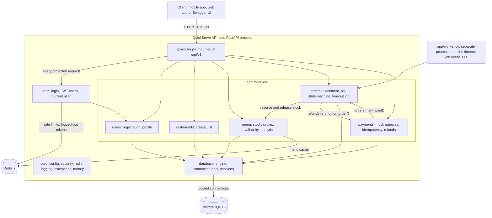

### 3.2 Inside every module: four layers

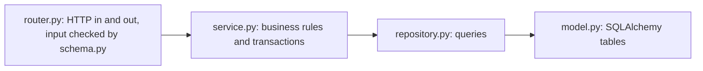

| Layer | Knows about | Never does |
|---|---|---|
| `router.py` | HTTP, status codes, request/response schemas | Business decisions |
| `schema.py` | Pydantic validation, what the API accepts and returns | Touch the database |
| `service.py` | Business rules, transactions, calling other modules | Raise `HTTPException` (so the same code works from a job or a script) |
| `repository.py` | SQL and ORM queries, locks | Business decisions |
| `model.py` | Tables, columns, constraints, relationships | Anything else |

### 3.3 Data model

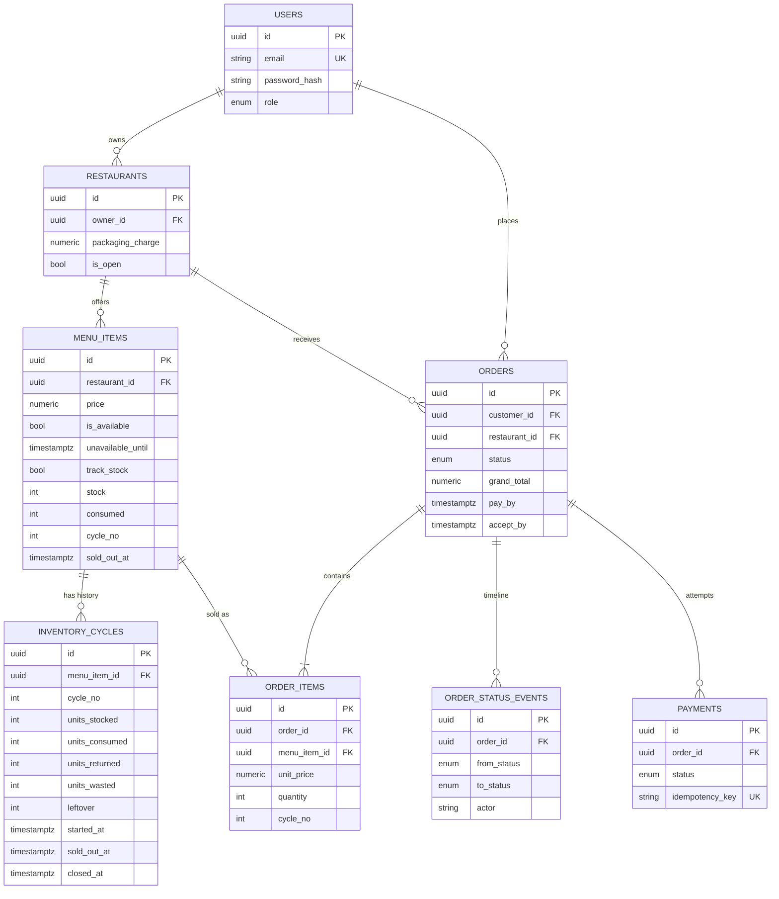

Rules the **database itself** enforces, so a bug in Python can't break them:

| Constraint | Rule |
|---|---|
| `ck_menu_items_stock_consistent` | `consumed <= stock` for tracked items; `stock` is NULL for untracked ones |
| `uq_inventory_cycles_one_open` (partial unique index) | At most one open stock cycle per item |
| `uq_payments_one_success_per_order` (partial unique index) | At most one successful payment per order |
| `uq_payments_idempotency_key` | A retried payment can't create a second charge |
| `uq_users_email` | No duplicate accounts, even with simultaneous sign-ups |
| `ck_order_items_quantity_positive`, `ck_menu_items_price_positive` | No zero/negative quantities or prices |

### 3.4 What happens when a customer places and pays for an order

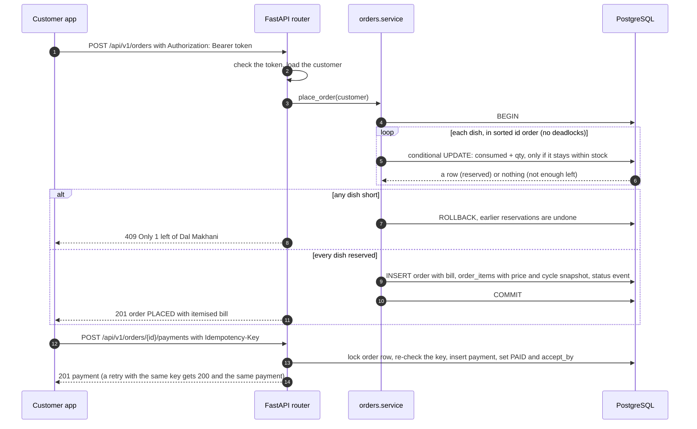

### 3.5 Order lifecycle

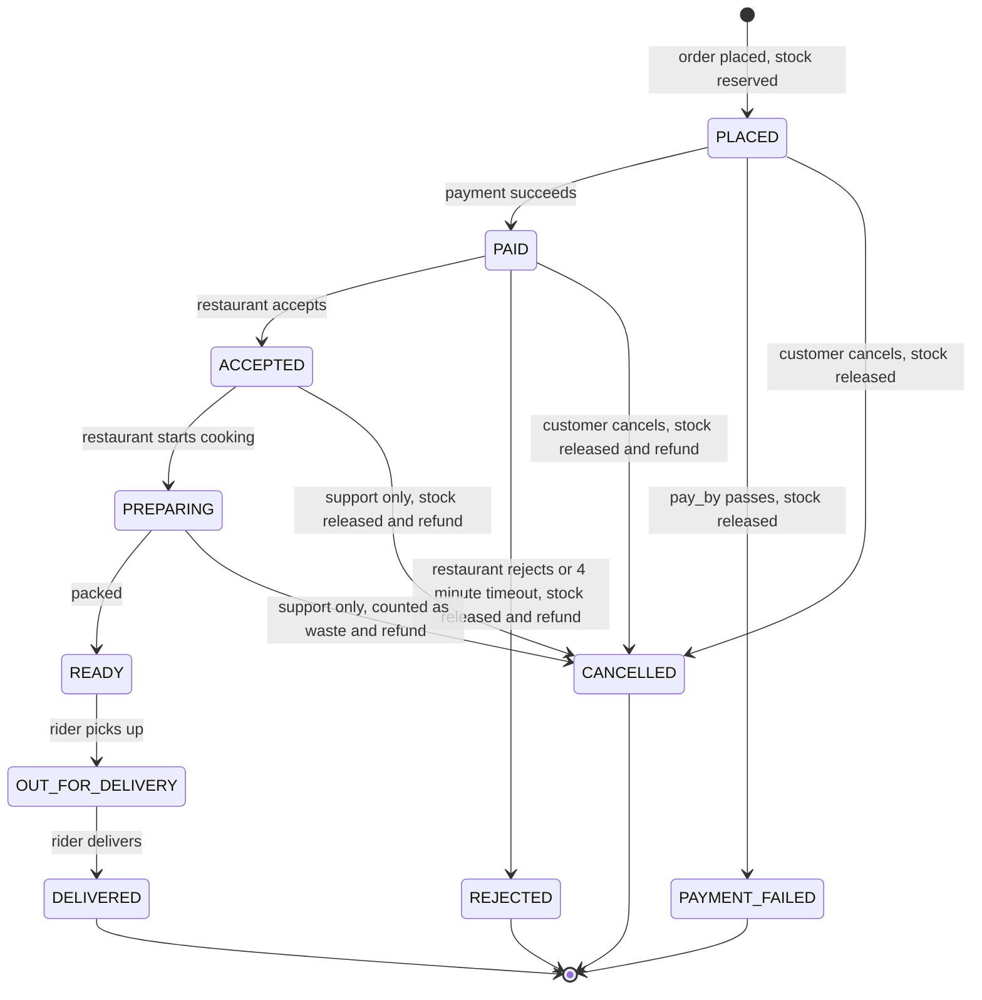

### 3.6 The stock cycle

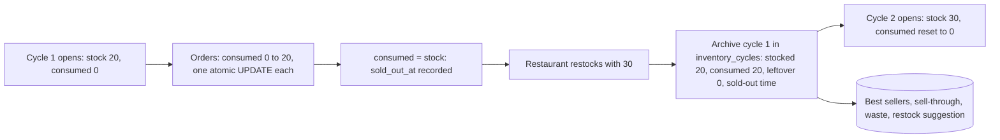

### 3.7 CI pipeline (runs on every push and pull request)

Two jobs run side by side, so adding the Docker job didn't make CI slower.

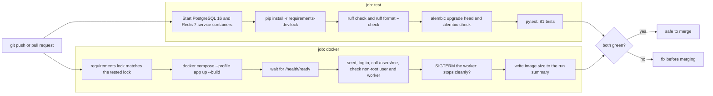

### 3.8 The whole stack in Docker Compose (Phase 5)

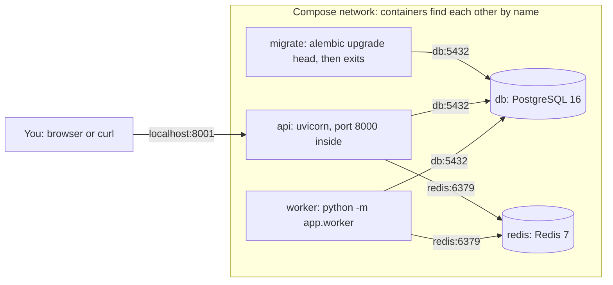

Start order, enforced by `depends_on`: `db` healthy → `migrate` finishes with exit code 0 → `api` and `worker` start. If the migration fails, the API never starts with a half-updated schema.

### 3.9 Where it's heading (planned, Phases 6 to 8)

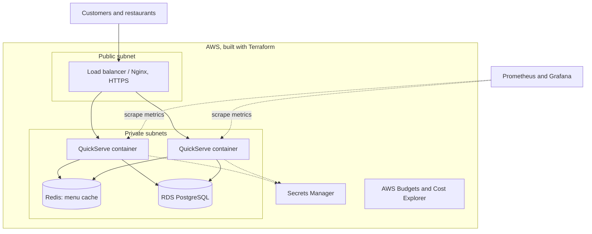

The app already runs in containers (3.8); the AWS part of this diagram is the plan for the phases in the [roadmap](#13-roadmap).

---

## 4. The inventory design: stock, consumed and cycles

### Q: In QuickKart we did `stock -= 1` on every sale and stopped at 0. What's wrong with that?

It works for "can I sell one more?", but it throws away information:

- After a few sales you can't tell how many were prepared. `stock = 4` could mean "made 5, sold 1" or "made 50, sold 46".
- When you restock, you overwrite the number, and that cycle's sales are gone.
- So you can't compute a best seller fairly, can't measure waste, and can't learn how much to prepare tomorrow.

It also has a concurrency trap if the code reads the stock into Python, subtracts, and writes it back. That trap is covered further down.

### Q: So what does QuickServe do instead?

It keeps two numbers per item, which is your "consumer and stock" idea. In code the counter is called `consumed` because it counts units consumed:

```
stock      = units prepared for the current cycle   (fixed during the cycle)
consumed   = units ordered so far in this cycle     (goes up with each order)
available  = stock - consumed                       (computed, never stored)
```

A **cycle** runs from one restock to the next. Restocking closes the current cycle, starts a new one, sets the new stock and resets `consumed` to 0:

```
   cycle 1 (stock = 20)                          cycle 2 (stock = 30)
 |-------------------------------------------| |------------------------- ...
 restock   consumed: 0 -> 5 -> 12 -> 20      restock   consumed: 0 -> 4 -> ...
 09:00                          ^ 13:10      18:00
                           sold_out_at       |
                                             +-- cycle 1 archived in inventory_cycles:
                                                 stocked 20, consumed 20, leftover 0,
                                                 sold out at 13:10, closed at 18:00
```

### Q: If consumed is reset to 0, isn't the sales history deleted?

It would be, and that's the one change needed to make your idea work. **Before resetting, the restock archives the closing cycle** into an `inventory_cycles` table: units stocked, units consumed, leftover, whether the leftover was carried forward, when it sold out, and when the cycle opened and closed. The live counter on `menu_items` stays small and fast for ordering; the history lives in its own table for analytics.

This is the classic split between **operational data** (the hot row every order touches) and **historical data** (append-only rows reports read).

### Q: What do we gain from this? The full list

1. **Fair best sellers.** Ranking by units sold rewards whatever you prepare most of. QuickServe ranks by *units sold per hour while the item was actually on sale* (more below).
2. **Sell-through rate** = units sold / units stocked. It's a standard retail metric: units sold divided by units received [5]. Retail guides treat about 75% or more as strong [6]. For food it reads directly: 40% means too much was cooked; 100% by lunchtime means too little.
3. **Sold-out time.** `sold_out_at` records the first moment a cycle hit zero. Sold out at 1 pm and sold out at 9 pm are very different signals that a plain counter can't tell apart.
4. **Restock suggestions that understand stock-outs.** When an item sells out, sales show only that demand was *at least* that much. Forecasting literature calls this **censored demand**: stock-outs cut off the sales you can observe, and models trained on that cut-off data underestimate demand, which leads to more stock-outs and more waste [7][9]. Estimating demand straight from sales is biased even when stock-outs are rare [8]. The suggestion endpoint corrects for this.
5. **Waste tracking.** Each cycle records the `leftover` at close and `units_wasted` (orders cancelled after cooking started). Multiply by food cost and you have the money lost to waste.
6. **Customer badges.** "Only 4 left" comes from `available`. "Selling fast" comes from the cycle's sales rate: at the current pace, will it sell out within the hour?
7. **An audit trail.** "On 17 Nov we made 20 biryanis, sold 18, 1 order was cancelled after the restock, 1 was cancelled while cooking." Each part of that sentence is a column.
8. **Made-to-order items still count.** A plain dosa might not be counted (`track_stock = false`, `stock = NULL`), but `consumed` still goes up, so it still appears in best-seller reports.
9. **Carry-over for packaged goods.** Cooked food is usually discarded at close, while a sealed lassi can roll into the next cycle. `carry_over_leftover` handles both, and the cycle records which happened.
10. **Correct cancellations across restocks.** Every order line remembers the `cycle_no` it was sold from (next question).
11. **A database-level guarantee.** A `CHECK (consumed <= stock)` constraint means PostgreSQL itself refuses an oversold value, even if a future bug slips through the code.

### Q: An order is placed, then the restaurant restocks, then the customer cancels. What happens to the stock?

This is the subtle case. If cancelling did `consumed -= 3` on the new cycle, it would hand out 3 phantom units that were never prepared in this cycle.

So each `order_items` row stores `cycle_no`, and releasing stock is a conditional update:

```sql
UPDATE menu_items SET consumed = consumed - 3
 WHERE id = :item AND cycle_no = :cycle_the_order_came_from AND consumed >= 3
RETURNING id
```

- **Same cycle:** the row matches and the 3 units go back on sale.
- **Item restocked since:** zero rows match. The service records the 3 units as `units_returned` on the *archived* cycle and leaves the new cycle untouched.

Test: `test_cancel_after_restock_credits_the_old_cycle`.

### Q: And a cancellation after cooking started?

The food exists but can't be resold, so the units are **not** released. They're counted as `units_wasted` on their cycle, and the customer is refunded. Customers can cancel only before the restaurant accepts; after that only support can.

### Q: Forty customers want the last ten biryanis at the same moment. What stops overselling?

One **conditional UPDATE** that checks and writes in the same statement:

```sql
UPDATE menu_items
   SET consumed = consumed + 1
 WHERE id = :item
   AND (NOT track_stock OR consumed + 1 <= stock)
RETURNING id, name, price, cycle_no
```

If it returns a row, the unit is reserved; if it returns nothing, the item can't cover the order. Two orders racing for the last unit can't both win. In PostgreSQL's default Read Committed level, the second UPDATE waits for the first to commit. It then **re-evaluates its WHERE clause against the updated row** and proceeds only if the row still matches [1]. It no longer matches, so it gets no row back.

You can watch the difference yourself with `python -m scripts.race_demo`. On the machine that built this project, both runs went like this every time:

```
NAIVE : 40 orders accepted for 10 biryanis | consumed counter says  3
        oversold by 30; the counter missed 37 sales (lost updates)
ATOMIC: 10 orders accepted for 10 biryanis | consumed counter says 10
```

The naive version reads `consumed` into Python, checks it, and writes `consumed + 1` back. Forty requests all read a small number, all pass the check, and overwrite each other's writes. Notice that the `CHECK (consumed <= stock)` constraint **didn't stop it**: every write stored a small, valid-looking number. It was just the wrong number. Constraints catch impossible values; only atomic updates or locks prevent **lost updates**.

Tests: `test_forty_customers_ten_biryanis`, plus the demo script.

### Q: What if a restock happens in the middle of a lunch rush?

Restocking has to read `consumed`, archive it and reset it, with no order sneaking in between. If one did, its sale would land in a cycle that had already been archived, or vanish. So restock takes a **row lock** first:

```sql
SELECT ... FROM menu_items WHERE id = :item FOR UPDATE
```

Orders for that item wait a few milliseconds and then land cleanly in the new cycle. The test fires 29 orders and 1 restock at the same instant, then checks that every unit sold is counted in exactly one cycle, and that the per-cycle totals match the `cycle_no` stored on each order line.

Test: `test_restock_in_the_middle_of_a_rush_loses_nothing`.

### Q: An order has paneer and naan, another has naan and paneer. Can they deadlock?

They could. If order A locks paneer then waits for naan, while order B locks naan then waits for paneer, each waits for the other forever. PostgreSQL detects this and kills one of them, which means a failed order. QuickServe **always reserves items in sorted ID order**, so two orders can never hold each other's next lock. It's a one-line fix that's easy to forget, and a common interview question.

### Q: Why rank best sellers by rate instead of units sold?

Take the numbers from `test_best_seller_is_ranked_by_rate_not_raw_volume`:

| | Prepared | Sold | On sale for | Units sold | Rate while available |
|---|---|---|---|---|---|
| Samosa | 200 | 120 | 10 h (never sold out) | **120** | about 11.7 per hour |
| Chicken Biryani | 20 | 20 | 1 h (then sold out) | 20 | **16 per hour** |

(Both items were then restocked, and the new, still-empty cycle counts for its 15-minute minimum: 120 / 10.25 h and 20 / 1.25 h. The test asserts these exact figures.)

By units sold, samosa "wins". But biryani ran out after an hour; after that nobody *could* buy it. Counting those empty hours would punish it for being popular. So for a sold-out cycle the clock stops at `sold_out_at`. Each cycle counts for at least 15 minutes, so one very early sell-out can't produce an absurd rate. Biryani ranks first. Sell-through is reported alongside the rate, because it says whether you prepared the right amount.

Platforms do tag best sellers. One published implementation tags items above the 97th percentile of order volume within a restaurant [18]. That's a volume rule; the rate-while-available rule here is the correction for stock-outs that the cycle data makes possible.

### Q: How does the restock suggestion work?

`GET /api/v1/menu/{id}/restock-suggestion` looks at the last 3 closed cycles:

- **Didn't sell out:** demand ≈ units sold.
- **Sold out:** sales are censored, so demand is estimated from the selling rate stretched over the whole cycle, capped at 2× sales. Example: 20 sold in the first 4 hours of an 8-hour cycle gives an estimate of about 40.
- The suggestion is the average of those estimates, rounded up, with an explanation for each cycle.

This is a deliberately simple teaching heuristic, not a production forecaster. Real systems use statistical models built for censored data [9]. The point is that **without archived cycles and `sold_out_at` you couldn't even begin**, because a plain stock counter has no way to tell "sold 20 because 20 people wanted it" from "sold 20 because we only made 20".

---

## 5. ORM vs writing SQL by hand

### Q: Is the ORM better than writing SQL queries manually?

For most of an application, yes. But "better" doesn't mean "you can forget SQL". The race demo above makes the point: **the ORM can generate both the wrong SQL and the right SQL, and only knowing SQL tells you which one you wrote.**

```python
# Python arithmetic on a value read earlier -> sends a literal: SET consumed = 4
item.consumed = item.consumed + 1

# A column expression -> sends SET consumed = consumed + 1 (atomic, done inside PostgreSQL)
update(MenuItem).values(consumed=MenuItem.consumed + 1)
```

Both look almost identical in Python. The first loses updates under concurrency; the second doesn't.

### Q: What does the ORM give us in this project? Concrete examples

| ORM feature | Where it's used | What you'd do by hand |
|---|---|---|
| **Unit of work**: you change objects, the session works out the INSERT/UPDATE order and runs them in one transaction | `place_order` creates an order, its items and a status event, all committed together | Order every statement yourself, manage `BEGIN`/`COMMIT`/`ROLLBACK` |
| **Relationships and loading strategies** | `selectinload(Restaurant.menu_items)` loads 3 restaurants and 9 dishes in exactly 2 queries (tested) | Write the join or the `IN (...)` query and stitch results into objects |
| **`lazy="raise"`** | Accessing `restaurant.menu_items` without asking for it raises an error instead of quietly running one query per restaurant (the N+1 problem) | No equivalent safety net |
| **Hybrid methods**: one rule, two worlds | `MenuItem.switched_on_at(now)` runs as Python on the menu page and becomes a SQL `WHERE` inside the order UPDATE, so they can never disagree | Write the rule twice and hope they stay in sync |
| **Column defaults and `onupdate`** | `updated_at` is set on every UPDATE automatically. `scripts/show_sql.py` shows the ORM adding `updated_at=now()` to the reservation UPDATE | Remember it in every UPDATE you write |
| **Bound parameters** | Every value is sent separately from the SQL text | Easy to slip into string formatting, the classic SQL-injection hole |
| **Migrations from models** | `alembic revision --autogenerate` wrote the first migration from the model classes; `alembic check` in CI fails if models and migrations drift apart | Write and maintain every `CREATE`/`ALTER` by hand |
| **Typed results** | `Mapped[Decimal]` columns come back as `Decimal`, `Mapped[OrderStatus]` as an enum | Convert types from raw rows yourself |

### Q: Where is raw SQL as good, or better?

- **Reports.** The best-seller report is written twice in `app/modules/menu/analytics.py`: once with SQLAlchemy (a CTE, `GROUP BY`, `RANK() OVER`) and once as plain SQL. A test proves they return identical rows. Be honest about it: for a report like this, many people find the SQL version easier to read. SQLAlchemy can express it, but the expression API is a second language. A reasonable rule: **ORM for business logic, raw SQL (or SQLAlchemy Core) for analytics.**
- **Bulk work.** Loading 100,000 rows as Python objects is slow; a single `INSERT ... SELECT` or `COPY` is far faster.
- **Database-specific features.** Partial indexes, `SKIP LOCKED` and `CHECK` constraints are all used here. SQLAlchemy supports them, but you still have to know they exist, which is a SQL skill.

### Q: What does the ORM hide that can bite you?

Three things, all demonstrated in `tests/test_orm_behaviour.py`:

1. **Hidden queries (N+1).** Default lazy loading turns a loop over 50 restaurants into 51 queries. We set `lazy="raise"` so that mistake fails in development.
2. **The identity map can serve stale data.** Within one session, each row is one Python object. If you hold an object and the row changes underneath you (another request, a script), **selecting it again returns the same object with the old values**. SQLAlchemy doesn't overwrite already-loaded objects unless you ask with `populate_existing`, `refresh()` or `expire()` [2]. This is especially dangerous with `SELECT ... FOR UPDATE`: you lock the row but read stale values, a known pitfall [3]. Every locking query in QuickServe uses `populate_existing=True` for this reason. (One of our own tests once passed by accident because of this; see section 11.)
3. **Autogenerate is a draft, not the truth.** Alembic's generated migration created PostgreSQL ENUM types in `upgrade()` but didn't drop them in `downgrade()`, so downgrade-then-upgrade failed with "type already exists". The fix was added by hand, and the test suite now runs downgrade and upgrade on every run. Always read a generated migration before committing it.

### Q: How do I see the SQL the ORM generates?

- `python -m scripts.show_sql` prints the compiled SQL for the reservation UPDATE, the restock lock, `selectinload`, and the best-seller report, without needing a database.
- `SQL_ECHO=true` in `.env` logs every statement the running app sends.
- `alembic upgrade head --sql` prints migration SQL instead of running it.

---

## 6. Business rules borrowed from Zomato and Swiggy

### Q: What happens if a restaurant never responds to an order?

On Zomato, according to a POS integrator's documentation, orders not reviewed within 4 minutes are auto-rejected, and that can't be disabled [15]. QuickServe does the same:

- On payment, the order gets `accept_by = paid_at + 240 seconds` (configurable).
- A background job finds `PAID` orders past `accept_by`, moves them to `REJECTED`, releases their stock and refunds the payment.
- The job claims rows with `FOR UPDATE SKIP LOCKED`, so several job workers can run side by side without processing the same order twice.
- If the restaurant taps Accept at the same instant the job fires, they meet at the order's row lock. If the restaurant gets it first, the job skips that row (`SKIP LOCKED`) and won't pick it up again, because it's no longer `PAID`. If the job gets it first, the restaurant's request waits, then sees `REJECTED` and fails the transition check. Either way there's never a "rejected and accepted" order.

The same job expires orders that were never paid (`pay_by`, 10 minutes by default) and gives their reserved stock back. This is the standard **reservation with a time limit** pattern: stock is held for you, but not forever.

### Q: How do restaurants mark a dish unavailable?

Swiggy's partner guide tells restaurants to proactively mark unavailable items as "Out of Stock" in the Inventory section until they're next available [16]. A sold-out dish left live on the apps costs a cancelled order, a refund and a lower rating [17], which is the whole reason stock tracking matters.

QuickServe supports three states through `PATCH /menu/{id}/availability`:

| `is_available` | `unavailable_until` | Meaning |
|---|---|---|
| true | null | On |
| false | 18:00 today | Off, and back on by itself at 18:00 |
| false | null | Off until someone switches it on |

The rule is a hybrid method, so the menu page and the order UPDATE apply exactly the same logic.

### Q: How is the bill calculated?

Like the itemised bills on delivery apps:

```
item total            250.00     sum of unit price x quantity (2 x Rs 125)
packaging charge       20.00     set by the restaurant
delivery fee           30.00     waived above Rs 299
platform fee           12.00     flat, per order
GST on food (5%)       13.50     on items + packaging
GST on fees (18%)       7.56     on delivery + platform fee
-------------------------------
grand total           333.06
```

Where the rules come from:

- **Platform fee.** A fixed per-order charge. In March 2026 Zomato raised it to Rs 14.90 before GST [10], and Swiggy raised its fee to Rs 17.58 including GST [11]. Both platforms change it often.
- **GST on food.** For orders through delivery apps, the e-commerce operator collects and deposits GST on the restaurant service under Section 9(5), at 5% without input tax credit [12].
- **GST on the platform's own fees.** Delivery charges billed by the operator, and platform fees, are a separate supply taxed at 18% [13]. Tax treatment of delivery keeps changing: a notification making operators liable for certain delivery services under Section 9(5) took effect on 1 November 2026 [14].

That is exactly why every fee and rate lives in `.env` / `Settings` and not in code: a fee change is a config change, not a redeploy. The defaults are illustrative and none of this is tax advice. The **whole bill is stored on the order**, so if the fee changes tomorrow, yesterday's receipts don't.

### Q: If a restaurant changes a price, do old orders change?

No. Each order line stores `item_name` and `unit_price` as **snapshots**. Test: `test_price_snapshot_survives_menu_price_change`.

### Q: Who can change an order's status, and when?

The lifecycle is data in `state_machine.py`, not scattered `if` statements:

```
PLACED --pay--> PAID --accept--> ACCEPTED --> PREPARING --> READY --> OUT_FOR_DELIVERY --> DELIVERED
  |              |                  |             |
  |              +--reject/timeout--+--> REJECTED  |
  +--timeout--> PAYMENT_FAILED      |             |
  +--cancel---> CANCELLED <---------+-------------+   (after ACCEPTED: support only)

Failed ending before PREPARING  -> stock released, payment refunded if one was taken
Failed ending from PREPARING    -> stock counted as waste, payment refunded
```

Each target status also lists who may set it: only the restaurant accepts, only a rider delivers, only the system marks an order paid. Who you are comes from your login token, never from the request ([section 7](#7-login-tokens-and-permissions)). `DELIVERED -> PREPARING` is impossible because `DELIVERED` allows no next state. Every change is written to `order_status_events`, which powers the timeline endpoint today and notifications later.

### Q: The customer taps "Pay", the network drops, the app retries. Are they charged twice?

No. The client sends an `Idempotency-Key` header. A `UNIQUE` constraint on that key means a retry returns the first result (`200`, `Idempotent-Replayed: true`) instead of creating a second charge. A partial unique index enforces **at most one successful payment per order** in the database itself:

```sql
CREATE UNIQUE INDEX uq_payments_one_success_per_order ON payments (order_id) WHERE status = 'SUCCESS';
```

Failed attempts are kept, and the customer can retry with a new key until `pay_by`. A concurrency test found a real bug here; see section 11.

---

## 7. Login, tokens and permissions

Phase 3 added login. Browsing restaurants and menus is still open to everyone; everything else needs you to be logged in, and what you may do depends on **who** you are and **what you own**.

### Q: What's the difference between authentication and authorization?

They're the two questions every request has to answer, in this order:

| | Question | Fails with | Example in QuickServe |
|---|---|---|---|
| **Authentication** | Who are you? | `401 Unauthorized` | No token, an expired token, a forged token, a wrong password |
| **Authorization** | Are you allowed to do *this*? | `403 Forbidden` (or `404`, see below) | A customer trying to accept an order; owner A restocking owner B's dish |

People mix the two up constantly, including in HTTP itself, where "401 Unauthorized" really means "unauthenticated".

### Q: How does logging in work?

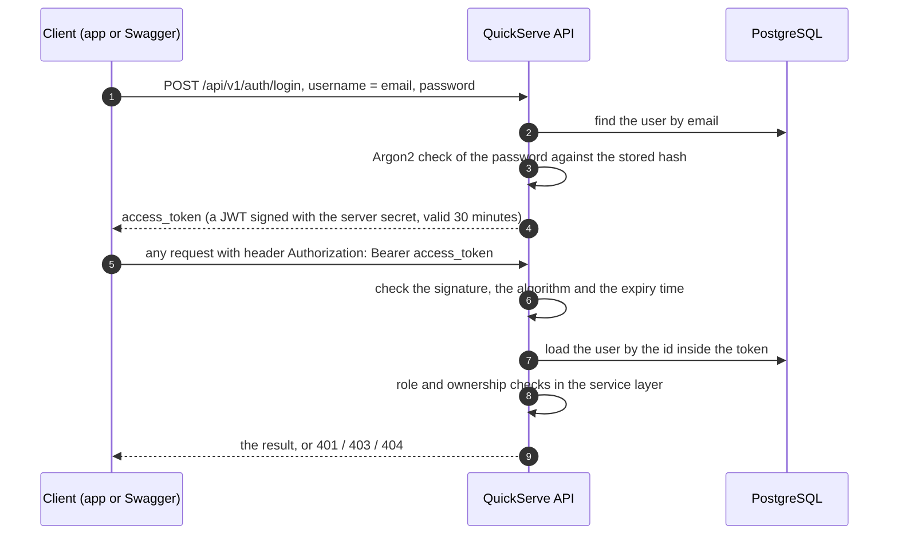

In code: `app/modules/auth/service.py` does the login, `app/core/security.py` creates and checks tokens, and `get_current_user` in `app/modules/auth/dependencies.py` is the FastAPI dependency that every protected endpoint uses.

### Q: What's inside a token? Is it secret?

A JWT has three parts separated by dots: `header.payload.signature`. Ours carries:

```json
{"sub": "<your user id>", "role": "CUSTOMER", "type": "access", "iat": 1763371200, "exp": 1763373000}
```

**The payload is not encrypted, just base64-encoded.** Anyone holding a token can read it. `test_editing_the_role_inside_a_token_breaks_it` decodes a customer's token without any key, changes `"role"` to `"ADMIN"`, and sends it back. The server rejects it, because the **signature** no longer matches the contents and only the server has the secret to make a new one. So:

- never put anything secret in a token (passwords, phone numbers, addresses);
- the secret (`JWT_SECRET_KEY`) is the crown jewel. Whoever has it can mint a token for any user.

### Q: The token already says `"role": "CUSTOMER"`. Why look the user up in the database on every request?

Because tokens can't be taken back once issued. If we trusted the role inside the token, then demoting a user or deleting a stolen account would only take effect when their token expired. Loading the user by id (one primary-key lookup) means role changes and deletions apply on the very next request. `test_token_of_a_deleted_user_is_401` checks this. The role in the token is only informational, for example for a frontend that wants to show the right menu.

The trade-off is the classic one between **stateless** (never touch the database, scale easily, can't revoke) and **stateful** (one query, can revoke). A short expiry (30 minutes) plus a database check is a sensible middle ground for a project like this.

### Q: How are passwords stored?

As **Argon2** hashes, via `pwdlib`. Argon2id is the first choice in OWASP's password storage guidance [27] and the algorithm FastAPI's tutorial uses [4]. Hashing is one-way: we can check a password against the hash, but nobody, including us, can turn the hash back into the password. That's the difference from encryption, which is reversible with the key.

Argon2 is **slow on purpose**: about 100 ms per check on the machine that built this. That's harmless for one login, and it makes guessing billions of passwords from a stolen database impractical. It's also why the test suite hashes its shared test password once instead of once per test user.

### Q: Why does a wrong password get exactly the same answer as an email that doesn't exist?

If the login said "no such email" in one case and "wrong password" in the other, anyone could find out which emails have accounts just by trying them (**account enumeration**). OWASP's testing guide asks applications to return consistent generic error messages when the account name, password or other credentials are wrong [24]. QuickServe always answers `401 Incorrect email or password` (`test_wrong_password_and_unknown_email_look_identical`).

The **timing** gives it away too: checking a password takes about 100 ms, but "no such user" could answer in 1 ms. So when the email doesn't exist, `verify_password` still runs one full Argon2 check against a dummy hash. Measured on the machine that built this: wrong password **108 ms**, unknown email **102 ms**, correct password **112 ms**. Indistinguishable from outside.

### Q: Who can do what?

| Action | Not logged in | Customer | Restaurant owner | Rider | Admin |
|---|---|---|---|---|---|
| Browse restaurants and menus | yes | yes | yes | yes | yes |
| Sign up | as customer, owner or rider | | | | |
| Create a restaurant | | | yes (becomes its owner) | | yes |
| Add dishes, restock, switch dishes off, cycle history, restock suggestion, best sellers | | | **own restaurant only** | | any |
| Place an order | | yes (it's theirs) | | | |
| Pay for an order | | own orders only | | | |
| See an order and its timeline | | own orders | orders of own restaurant | orders that are READY or later | all |
| Accept, reject, start preparing, mark ready | | | own restaurant's orders | | |
| Picked up, delivered | | | | yes | |
| Cancel | | own order, before the restaurant accepts | | | any, before delivery |
| Run the timeout job | | | | | yes |

The order status rules from section 6 still apply on top of this: even the right person can't move an order from DELIVERED back to PREPARING.

### Q: Why isn't "you're a restaurant owner" enough to restock a dish?

Because then owner A could restock B's dishes, add dishes to B's menu or read B's sales figures, just by putting B's ids in the URL. Checking the role but forgetting **ownership of that specific object** is the number one API security risk on OWASP's 2023 list: Broken Object Level Authorization [26]. Every menu action goes through `ensure_can_manage(db, restaurant_id, user)`, which checks that the restaurant belongs to the caller (admins excepted). `test_owner_cannot_touch_another_owners_menu` tries all three attacks.

### Q: Why do I get `404 Not Found` for someone else's order, and not `403 Forbidden`?

`403` would confirm "this order exists, you just can't see it". `404` reveals nothing. The same order id answers `200` for its customer, its restaurant's owner and admins, and `404` for everyone else. Riders get `404` until the order is READY, because there's nothing for them to do before then.

### Q: Why can't I sign up as an admin? Where do riders and admins come from?

The sign-up schema only accepts `CUSTOMER`, `RESTAURANT_OWNER` or `RIDER`. If anyone could register as an admin, the role would protect nothing. Admins (and the demo rider) are created by `scripts/seed.py`. In a real system an existing admin would create them through a protected endpoint.

### Q: Adding the RIDER role needed a hand-written migration. Why?

Alembic's autogenerate **doesn't notice** a new value in a Python `Enum`. It would have produced an empty migration, and production would have crashed the first time a rider signed up. The migration (`migrations/versions/..._add_rider_role.py`) runs `ALTER TYPE user_role ADD VALUE 'RIDER'`. PostgreSQL can't remove an enum value, so the downgrade rebuilds the type, and it **refuses to run if rider accounts exist** rather than silently turning them into customers. A lesson from Phase 2 again: autogenerate is a draft.

### Q: What stops someone from forging a token?

- **The algorithm is pinned.** The server only accepts `HS256`. A famous JWT attack sends a token whose header says `"alg": "none"` (no signature at all); `test_unsigned_alg_none_token_is_401` shows it's rejected.
- **The secret must be real outside your laptop.** The app refuses to start when `ENVIRONMENT` isn't `local` and `JWT_SECRET_KEY` is still the development value from `.env.example`, or when the secret is shorter than 32 characters (`test_dev_secret_is_refused_outside_local`). Failing loudly at startup beats running in production with a secret that's published on GitHub. In Phase 6 the real secret comes from AWS Secrets Manager.
- **Tokens expire** after 30 minutes (`ACCESS_TOKEN_EXPIRE_MINUTES`), which limits the damage if one leaks.

### Q: What's deliberately not built yet?

| Missing | Why it matters | When |
|---|---|---|
| Refresh tokens | Today you log in again every 30 minutes | Later |
| ~~Logout / revoking a token~~ | ~~A leaked token works until it expires~~ | **Done in Phase 4** ([section 8](#8-redis-the-background-worker-and-logs-phase-4)) |
| ~~Rate limiting on login~~ | ~~Someone could try thousands of passwords~~ | **Done in Phase 4** ([section 8](#8-redis-the-background-worker-and-logs-phase-4)) |
| HTTPS | Tokens and passwords must never travel in plain text | Phase 6: TLS at the load balancer |
| Rider assignment | Any rider can deliver any READY order | Later |

### Q: How do I log in on the Swagger page?

1. Open http://127.0.0.1:8000/docs and click **Authorize** (top right, padlock icon).
2. Put the **email** in the `username` box (it's called username because that's the OAuth2 standard form) and the password in `password`. Leave the other fields empty.
3. Click **Authorize**, then **Close**. Padlocks on the endpoints now show as locked, and Swagger sends your token with every request.
4. To switch user, click **Authorize** again, then **Logout**, then log in as someone else.

The demo accounts are printed by `python -m scripts.seed`:

| Role | Email | Password |
|---|---|---|
| Customer | `customer@quickserve.dev` | `customer-pass-123` |
| Restaurant owner (owns both demo restaurants) | `owner@quickserve.dev` | `owner-pass-123` |
| Rider | `rider@quickserve.dev` | `rider-pass-123` |
| Admin | `admin@quickserve.dev` | `admin-pass-123` |

These are for local development only.

---

## 8. Redis, the background worker and logs (Phase 4)

Phase 4 added three production habits: a **cache** for the busiest page, a **background worker** so the timeout job runs by itself, and **structured logs** you can search. It also finished two items Phase 3 left open: **login rate limiting** and **logout**.

### Q: What is Redis, and what does QuickServe keep in it?

Redis is an in-memory key-value store: reads and writes take microseconds, keys can **expire on their own** (a TTL), and counters can be increased **atomically**. QuickServe uses it only for data that's fine to lose:

| Key | What it holds | Expires after |
|---|---|---|
| `menu:v1:<restaurant id>` | The customer menu, ready to send | 10 seconds (`MENU_CACHE_TTL_SECONDS`) |
| `login:fail:email:<email>` | Failed logins for one account | 15 minutes from the first failure |
| `login:fail:ip:<ip>` | Failed logins from one IP address | 15 minutes from the first failure |
| `auth:revoked:<token id>` | A token that was logged out | When that token would have expired anyway |

PostgreSQL stays the **source of truth** for everything that matters: orders, stock and money never live only in Redis. You can look inside while the app runs with `docker compose exec redis redis-cli --scan`.

### Q: How does the menu cache work?

It's the **cache-aside** pattern:

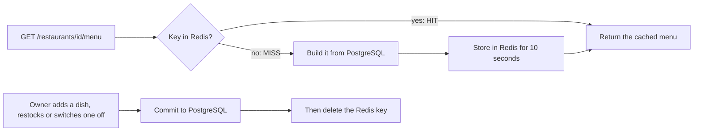

Every menu response has an `X-Cache` header: `MISS` (built from the database), `HIT` (from Redis) or `BYPASS` (Redis unavailable). Try `curl -I http://127.0.0.1:8000/api/v1/restaurants/<id>/menu` twice.

### Q: Why delete the cache entry *after* the database commit, not before?

Because of the gap between the two. If we deleted first, another request could arrive before our commit, find the key missing, rebuild the menu from the **old** rows, and put that stale copy back in Redis for the whole TTL. Deleting after the commit means the next rebuild can only see the new data. It's the kind of ordering detail that interviewers like to ask about.

### Q: Orders don't clear the cache. So the menu can say "2 left" when there are none?

Yes, for at most 10 seconds, and that's a deliberate trade-off. A popular restaurant gets orders every few seconds; clearing the cache on each one would mean almost no cache hits. What makes it safe: **placing an order never trusts the menu**. It runs the atomic stock UPDATE in PostgreSQL, so a slightly stale "2 left" can never sell a third biryani. `test_a_stale_menu_can_never_cause_an_oversell` shows exactly that: stale menu, `HIT`, and the order is still refused.

The general rule: **cache what's allowed to be a little old; check the source of truth for anything that must be right.**

### Q: What happens when Redis goes down?

Every feature degrades on purpose, and each choice is a trade-off:

| Feature | With Redis down | Why this choice |
|---|---|---|
| Menu | Served straight from PostgreSQL (`X-Cache: BYPASS`) | Slower, but nobody notices a missing cache |
| Login rate limit | Paused (**fails open**); a warning is logged | Refusing every login would turn a cache outage into "nobody can log in". A bank might choose the opposite |
| Logout check | Paused (fails open); logged-out tokens work until they expire | Same availability argument; tokens expire in 30 minutes anyway |
| Logging out | **Refused** with `503` | Silently "succeeding" would make users believe they're logged out when they aren't |
| `/health/ready` | Still **ready**, with `"redis": "down (degraded...)"` | Pulling every instance out of the load balancer would make a small problem a total outage |

A test caught a nasty surprise here: by default the Redis client **retries a failed command several times with growing pauses**, so with Redis down every menu request took about **4 seconds**. "Degraded" had quietly become "unusable". The client now retries once, immediately, and `test_menu_still_works_when_redis_is_down_and_stays_fast` fails if a request takes longer than a second.

### Q: How does login rate limiting work?

Two counters per failed login, both in Redis: one for the **account** (5 failures per 15 minutes) and one for the **IP address** (20 per 15 minutes). The IP limit stops one machine from trying one common password against thousands of accounts ("password spraying").

- `INCR` is atomic, so two failures arriving at once can't both read "4" and both write "5".
- `EXPIRE ... NX` starts the 15-minute window on the **first** failure only, and the key deletes itself afterwards. No cleanup job.
- The check runs **before** the password check, so a locked-out attacker gets nothing, not even a wrong-password answer.
- After the limit, even the **correct** password gets `429 Too Many Requests` with a `Retry-After` header (seconds until the window ends).
- A successful login clears the account's counter.

This is a **fixed window**: simple and cheap, but someone could make 5 attempts at minute 14 and 5 more at minute 16. A sliding window fixes that at the cost of more Redis work. Good to know for interviews.

There's a FinOps angle too: a blocked attempt is answered in about **2 ms**, while a real password check takes about **110 ms** of Argon2 CPU time (both measured on the machine that built this). A guessing attack against a rate-limited login costs almost nothing to turn away.

### Q: How can logout work if tokens can't be taken back?

Each token now carries a unique id (`jti`). `POST /api/v1/auth/logout` stores that id in Redis under `auth:revoked:<jti>`, with a TTL equal to the token's remaining lifetime, and `get_current_user` rejects any token on that list. When the token would have expired anyway, the Redis key disappears too, so the deny list never holds more than 30 minutes of logouts. Logging out on one phone doesn't affect your other devices (`test_logout_kills_this_token_only`).

Tokens issued before Phase 4 have no `jti`, so they're rejected: everyone simply logs in again once.

### Q: Why is the timeout job a separate worker process instead of part of the API?

Run it next to the API:

```bash
python -m app.worker           # runs the job every WORKER_INTERVAL_SECONDS (30)
python -m app.worker --once    # one pass, then exit
```

- The API may run as several processes on several machines. A timer inside each would run the job many times over. A worker is deployed, scaled and restarted on its own.
- A slow job never steals CPU from customers' requests.
- **Running two workers is safe.** The job claims orders with `SELECT ... FOR UPDATE SKIP LOCKED`, so each worker takes different rows. `test_two_workers_never_process_the_same_order` runs two workers at once over 20 expired orders: exactly 20 rejections, never one order twice. A second worker is for resilience (one machine dies, the other keeps going), not speed.
- If one pass fails (say the database is restarting), the worker logs the error and tries again next interval instead of crashing.

### Q: What's graceful shutdown, and why does the worker care?

When Docker stops a container, it sends `SIGTERM` and, if the process hasn't exited after a timeout (10 seconds by default for Linux containers), it's forcibly killed with `SIGKILL` [28]. Kubernetes does the same, with a default grace period of 30 seconds before `SIGKILL` [29]. A process killed mid-transaction leaves work half done.

The worker catches `SIGTERM` (and Ctrl+C), finishes the pass it's in, and exits. While it's waiting between passes, it stops **immediately**, not after up to 30 seconds. Measured: worker started, `SIGTERM` sent while it was waiting, clean exit within a second. `test_stop_signal_ends_the_loop_without_waiting_out_the_interval` checks it.

### Q: Why JSON logs, and what is a request ID?

Every request now produces exactly one log line like this:

```json
{"time": "2026-11-17T09:45:50.973+00:00", "level": "INFO", "logger": "quickserve.http", "message": "request",
 "request_id": "c776e4b1ba264ee5b74211062aa5e6c2", "method": "POST", "path": "/api/v1/auth/login",
 "status": 429, "duration_ms": 2.3}
```

- **JSON**, because in production thousands of lines a second from many instances go into a log system (CloudWatch, Loki, ELK), and JSON lets it filter and count by field: "all 500s today", "logins blocked per hour". Set `LOG_JSON=false` for readable plain text while coding.
- **A request ID** links every line that one request wrote (the access line, "login blocked", "order placed"…). It's returned in the `X-Request-ID` response header, so a user reporting a problem can quote it. If the caller sends a sensible `X-Request-ID`, it's reused, so one ID can follow a request across services; anything odd (spaces, quotes, too long) is replaced, so nobody can inject fake log lines.
- **Unexpected errors** return `{"detail": "Internal server error", "request_id": "..."}`. The full stack trace goes into **our** logs and never to the client, because traces can reveal file paths, SQL and secrets (`test_unexpected_errors_return_a_request_id_not_a_stack_trace`).
- **What's never logged:** passwords, emails on failed logins (people sometimes type their password into the email box), and query strings (they can contain personal data).
- **Business events** are logged too: `order placed`, `order status changed`, `login failed`, `login blocked`, `timeout job finished`.

FinOps: log platforms bill by the volume ingested and stored. One line per request plus real events (not every SQL statement) keeps that bill sane, and uvicorn's own access log is switched off because it would duplicate ours line for line.

Two logging bugs turned up while building this, both worth remembering:

1. **All our logs vanished in the tests.** The test setup runs the Alembic migrations, and Alembic's logging setup (`fileConfig`) switches off every logger that already exists by default. Fixed with `disable_existing_loggers=False` in `migrations/env.py`.
2. **Request IDs went missing from some lines.** The ID was read when a line was *written out*, but lines can be written out later, elsewhere (a background log-shipping thread, or a test inspecting them afterwards). It's now stamped onto each log record the moment the record is created, inside the request.

### Q: Why does Redis in Docker Compose have a memory limit and `volatile-ttl`?

Redis keeps everything in RAM, and RAM is what you pay for, so `--maxmemory 64mb` caps it. When the cap is reached, the eviction policy decides what to drop. `volatile-ttl` evicts keys that have an expiry, **shortest remaining time first** [30]. That suits us: menu entries (seconds left) go before login counters and logged-out tokens (minutes left), so memory pressure throws away the cheapest data first. Snapshots to disk are switched off, because nothing in this Redis needs to survive a restart.

### Q: How do I run all of it?

`docker compose up -d` now starts PostgreSQL **and** Redis (on port **6380** on your machine, so it can't clash with any other project's Redis). Then use two terminals, both with the venv active:

```bash
# terminal 1: the API
uvicorn app.main:app --reload

# terminal 2: the worker
python -m app.worker
```

`http://127.0.0.1:8000/health/ready` should show `"database": "ok", "redis": "ok"`.

Or skip the two terminals and run everything in containers: `docker compose --profile app up -d --build`, then use port 8001 (next part).

### Docker: the app in containers (Phase 5)

The Dockerfile itself is explained line by line in [docs/docker.md](docs/docker.md). These are the questions about how it all fits together.

### Q: Why put the app in a container at all? It already runs with `uvicorn`.

On your Mac it runs because your Mac has the right Python, the right packages in a venv and the right settings. A server has none of that. An image packs the code, Python and every package into one file that runs the same everywhere: your laptop, CI, AWS, Kubernetes. "Works on my machine" stops being a sentence anyone says. Every later phase (ECS on AWS, Kubernetes) runs this exact image.

### Q: Why is the Dockerfile split into two stages?

The first stage (`builder`) installs the packages into a virtual environment. The second stage (`runtime`) starts again from a clean `python:3.11-slim` and copies in only that finished environment and our code. pip's caches, build leftovers and the tools used to install things stay behind in the first stage. Smaller image, less to download on every deploy, and fewer programs an attacker could use [31].

### Q: Why does the container run as a user called `app` and not root?

If someone finds a bug that lets them run commands inside the container, they get the powers of the user the app runs as. As root, they could change any file in the container and have an easier path to attacking the host. As `app`, a user with no home and no login shell, they can't even overwrite the app's own code. Docker's own guidance is to drop root whenever the app doesn't need it [31]. CI checks this on every run: `whoami` inside the API container must print `app`.

### Q: The image installs `requirements.lock`. Why not `requirements.txt`?

`requirements.txt` pins only the packages we chose. Build the same commit next month and pip could pull a newer version of some dependency of a dependency, one the tests never ran with (exactly what happened with `starlette`; see [section 9](#q-why-both-requirements-devtxt-and-requirements-devlock)). `requirements.lock` pins all 37 runtime packages. The tests run on `requirements-dev.lock`, so CI checks that every line of `requirements.lock` appears, at the same version, in the dev lock. The image therefore contains exactly what was tested, minus pytest and ruff.

### Q: The API, the worker and the migration job: three images?

One image, three commands. `migrate` runs `alembic upgrade head`, `api` runs the Dockerfile's default command (`uvicorn`), `worker` runs `python -m app.worker`. Compose tags it three times, but the layers are shared, so it takes the disk space of one. One image means the API and the worker can never be on different versions of the code, and there's only one thing to build, scan and store.

### Q: Why is the migration its own container instead of the first thing the API does?

Picture production with five API containers starting together during a deploy. If each one ran `alembic upgrade head` on start, five processes would try to change the same tables at once. Running the migration **once per deploy**, before the new API version starts, is the standard pattern (on Kubernetes it becomes a Job, on ECS a one-off task). Compose expresses it with `depends_on: condition: service_completed_successfully` [33]: the API waits until `migrate` has exited with code 0, and doesn't start at all if it failed.

### Q: Inside Docker the database URL says `db:5432`. On my Mac it's `localhost:5434`. Why?

Compose puts the containers on a private network where each one is reachable by its **service name** on its **normal** port. The API container connects to `db:5432`. The `5434:5432` line in `docker-compose.yml` is only a door from your Mac into that network, and it exists so that you (and the developer-mode API) can reach the database. Inside a container, `localhost` means that container itself, which is why `localhost:5434` wouldn't work there.

### Q: Why is the worker's health check switched off?

The Dockerfile's `HEALTHCHECK` asks `http://127.0.0.1:8000/health`. That's right for the API. The worker runs the same image but listens on no port, so the check would always fail and Docker would mark it `unhealthy` forever. `healthcheck: disable: true` in Compose turns it off for the worker and the migration job. A better worker check, such as a heartbeat timestamp the worker writes every pass, comes with monitoring in Phase 7.

### Q: What happens when I run `docker compose stop`?

Docker sends `SIGTERM` to process 1 in each container. Because the Dockerfile uses the exec form (`CMD ["uvicorn", ...]`, not `CMD uvicorn ...`), process 1 is Python itself and receives it directly, instead of a shell that would swallow it. Uvicorn finishes the requests in progress; the worker finishes its current pass and logs `worker stopped cleanly`. If a container is still running after its grace period (10 seconds by default, 20 for the worker), Docker sends `SIGKILL`. CI tests the worker's clean stop on every run. Kubernetes does exactly the same when it moves a pod, which is why this matters later.

### Q: What does the CI `docker` job prove that the tests don't?

The tests prove the code is right. The `docker` job proves the **image** is right: it builds, it starts, the migrations run inside it, it reaches the database and Redis by service name, the seed script and login work, it runs as non-root, and the worker stops cleanly. Many deploy failures are not code bugs but a missing file in the image, a wrong path or a setting that only exists on someone's laptop; this job catches them before merge. It also writes the image size into the run's summary page, so a sudden jump is visible in review.

### Q: What does the image cost?

Claude Code measured it on the Mac: about **387 MB** on disk and about **82 MB** compressed, which is what a registry stores and every deploy downloads. Only about 0.3 MB of that is our code; most is Python and the libraries. Amazon ECR charges about USD 0.10 per GB per month for storage, for every version kept; pulls within the same AWS region are free, but cross-region pulls are billed per GB [32]. Check current pricing for your region before relying on these numbers. So in Phase 6 we'll add a registry lifecycle rule that keeps only the last few versions. The cheap wins already taken: a `slim` base image, two stages, no test tools in the image, and a `.dockerignore` that keeps `venv/`, `.git/` and tests out of the build.

---

## 9. DevOps already in the project

### Q: Why do the tests use a real PostgreSQL instead of SQLite?

Because the features that make this app correct (row locks, `SKIP LOCKED`, partial unique indexes, `RETURNING`, CHECK constraints under concurrency, Read Committed re-checks) either don't exist in SQLite or behave differently there. A test that passes on SQLite would prove nothing about production. The test suite builds its database **by running the real Alembic migrations**, down and up, so every test run also tests the migrations.

### Q: What runs in Docker Compose?

PostgreSQL 16 and Redis 7 always, the same major versions as CI and, later, AWS. With `--profile app` [34] it also builds the app image and runs the migration job, the API and the worker ([the Docker Q&A](#docker-the-app-in-containers-phase-5)). Without the profile, you run the app on your machine with `--reload` for fast edit-and-retry. The Compose file already shows two production habits: a **healthcheck** for each service (`pg_isready`, `redis-cli ping`), so dependants wait until they're truly ready, and **resource limits**, which on a laptop protect your machine and in the cloud are what you pay for.

### Q: What does the CI pipeline do, and why each step?

`.github/workflows/ci.yml` runs on every push and pull request:

| Step | Why |
|---|---|
| Install from `requirements-dev.lock` | Exact versions of every package, including dependencies of dependencies (next question) |
| `ruff check` and `ruff format --check` | Style arguments end; obvious bugs (unused imports, shadowed names) caught before review |
| `alembic upgrade head` + `alembic check` | **Fails if someone changed a model but forgot to create a migration**, a very common production incident |
| PostgreSQL 16 and Redis 7 **service containers** | Tests run against the same database and cache as production |
| `pytest` | All 81 tests, including the concurrency, login-attack and Redis-outage tests |
| `concurrency: cancel-in-progress` | Two quick pushes cancel the older run instead of paying for both |
| `timeout-minutes: 10` | A hung job can't burn CI minutes forever |
| A second job, `docker`, in parallel | Builds the image and smoke-tests the whole stack in containers ([details](#q-what-does-the-ci-docker-job-prove-that-the-tests-dont)) |

### Q: Why both `requirements-dev.txt` and `requirements-dev.lock`?

`requirements*.txt` pins the packages we chose. But those packages have their own dependencies, which aren't pinned. This bit us while building the project: a fresh install pulled a newer `starlette` (1.10.0, where another environment had 1.7.0), and the tests started printing a deprecation warning about the HTTP test client. The `.lock` file is `pip freeze` from an environment where the whole test suite passed on Python 3.11: every package at an exact version. CI installs from the lock, and the Docker image from `requirements.lock` (the runtime-only subset, checked against it in CI), so a new release of some sub-dependency can't break a build overnight. You regenerate the lock on purpose, when you upgrade.

### Q: What's the difference between `/health` and `/health/ready`?

- **Liveness** (`/health`): is the process alive? Kubernetes **restarts** the container if this fails. It deliberately doesn't touch the database: if the DB goes down, restarting every healthy app container in a loop makes things worse.
- **Readiness** (`/health/ready`): can this instance serve traffic right now? It runs `SELECT 1`. If it fails, the load balancer **stops sending requests** to this instance, but nothing gets restarted.

Mixing the two up is a classic cause of cascading outages.

### Q: What is connection pooling, and why does it matter for cost?

Opening a PostgreSQL connection costs a network round trip, authentication and a new server process. The SQLAlchemy engine keeps a **pool** of open connections (`pool_size=5`, plus up to `max_overflow=10` under bursts) and lends one to each request. `pool_pre_ping` detects connections that the database or a firewall silently dropped.

The trap comes at deploy time. PostgreSQL allows 100 connections by default. Each app process has its own pool:

```
4 uvicorn workers x (5 + 10) connections x 3 replicas = 180 possible connections  >  100
```

Scale out under load and new requests start failing to connect. You can fix it with smaller pools, a connection pooler such as PgBouncer, or a bigger database. A bigger database **just to hold idle connections** is money spent on nothing. That's where DevOps and FinOps meet: a config line becomes a monthly bill.

### Q: Why does the code use the database's clock (`now()`) instead of Python's?

With several app servers, each machine's clock drifts a little. Deadlines like `pay_by` and `accept_by`, and timestamps like `sold_out_at`, all come from one source of truth, PostgreSQL, so comparisons between them are always consistent.

### Q: How are settings and secrets handled?

All configuration comes from environment variables or `.env`, read by `pydantic-settings` (the "config in the environment" rule of twelve-factor apps). `.env` is git-ignored; `.env.example` documents every setting. The same code (and later the same Docker image) runs locally, in CI and in the cloud, and only the environment changes. In Phase 6 secrets move to AWS Secrets Manager or SSM Parameter Store. The app already guards the most important one: it refuses to start outside local development if `JWT_SECRET_KEY` is still the published development value.

### Q: What will we monitor once this is deployed?

The standard starting point is the four golden signals: latency, traffic, errors and saturation. This design also produces **business signals** that are just as useful on a dashboard:

- auto-rejected orders per restaurant (a restaurant tablet is offline, or the kitchen is overloaded)
- sell-outs per hour and time-to-sell-out (kitchen under-prepared)
- waste units per cycle (kitchen over-prepared)
- failed payment attempts (gateway trouble)
- connection pool waits (the database is the bottleneck)

These become Prometheus metrics and Grafana panels in Phase 7.

---

## 10. FinOps: thinking in cost per order

### Q: What is FinOps, in one paragraph?

Cloud costs are variable and controlled by engineers' choices (instance sizes, replicas, log volume, idle environments). FinOps is the practice of making those costs visible, owned and optimised. The FinOps Foundation's framework treats **unit economics** as a core capability: expressing cost per unit of business value, such as cost per customer or per transaction, instead of looking only at the total bill [19][20].

### Q: What's QuickServe's unit metric?

**Cost per completed order** = infrastructure cost for a period / orders delivered in that period. A worked example with **made-up round numbers**, just to show the reasoning:

```
Suppose the month's infrastructure costs Rs 3,000 and 1,500 orders are delivered.
Cost per order = 3,000 / 1,500 = Rs 2.00
```

Now compare it with revenue per order. Real platforms charge a flat platform fee per order (Zomato's was Rs 14.90 before GST as of March 2026 [10]). If infrastructure costs Rs 2 per order, that's a big chunk of a Rs 15 fee before delivery, support or marketing. Two questions follow, and that's the point of the metric:

- **Does cost grow slower than orders?** If orders double and cost per order falls, the system scales efficiently. If cost per order climbs, something is wasteful.
- **Which component dominates?** Usually the database, then compute, then logs and data transfer.

We'll measure this for real in Phase 8, first on one EC2 instance and then on Kubernetes. For a small app the single instance usually wins on cost, and seeing that with your own numbers is the lesson.

### Q: How does the inventory design connect to FinOps?

The kitchen has the same problem as the cloud, with food instead of servers:

| Kitchen (this app) | Cloud (FinOps) |
|---|---|
| Units prepared (`stock`) | Capacity provisioned (vCPUs, instances) |
| Sell-through = sold / prepared | Utilisation = used / provisioned |
| Leftover and `units_wasted` | Idle resources you still pay for |
| Sold out at 1 pm (censored demand) | Throttling, queueing, dropped requests |
| Restock suggestion | Rightsizing recommendation |
| Fixed per-cycle stock | Reserved capacity; autoscaling is "cook to order" |

Explaining the cycle data this way shows you understand FinOps as a way of thinking, not just a list of AWS tools. It works well in interviews.

### Q: What cost decisions are already in the code?

| Decision | Cost reason |
|---|---|
| `SQL_ECHO=false` by default | Logging every statement multiplies log volume, and log storage and ingestion are billed |
| Pooled connections and pool limits | Avoids buying a bigger database just to hold connections |
| Paginated list endpoints | An unbounded `SELECT` costs CPU, memory and data transfer, and grows with the table |
| Indexes matched to real queries (`status, accept_by` for the timeout job; `restaurant_id, status` for the restaurant's order queue) | Fewer full scans means a smaller database instance |
| The report reads archived cycles, not millions of order rows | Cheap analytics; later it can run on a read replica or a nightly summary |
| CI cancels superseded runs, has a timeout and caches pip | CI minutes are billed |
| Menu cached in Redis for 10 seconds | The most-read page stops hitting PostgreSQL on every view, so a smaller database handles more customers |
| Login rate limiting checked before the password | A blocked guess costs ~2 ms instead of ~110 ms of Argon2 CPU, so attacks are cheap to turn away |
| Redis capped at 64 MB with `volatile-ttl` eviction | RAM is the expensive part of a cache; the cap makes the cost fixed and predictable |
| One JSON log line per request, uvicorn's duplicate access log off | Log platforms bill by volume ingested and stored |
| Container resource limits in Compose | The habit that becomes Kubernetes requests/limits, which decide node count and therefore cost |
| Separate dev and runtime dependencies | Smaller production images: faster pulls, less registry storage |
| Slim base image, two-stage build, `.dockerignore` | About 82 MB compressed; registry storage and cross-region pulls bill per GB |
| One image for API, worker and migrations | One thing to build, scan and store instead of three |
| CI writes the image size to every run's summary | A size jump is seen in review, not on the bill |
| Limits on every container in Compose (API 1 CPU / 512 MB, worker 0.5 CPU / 256 MB) | First guesses for the Kubernetes requests and limits that decide node count in Phase 7 |

### Q: How do I avoid a surprise AWS bill?

- **Know the free tier you actually have.** AWS changed it on 15 July 2025. New accounts get up to USD 200 in credits (USD 100 at sign-up and up to USD 100 more for exploring services) and can choose a Free plan that lasts up to 6 months or until the credits run out [21]. When a Free plan ends, AWS closes the account and keeps the content for 90 days [22]. Many tutorials still describe the old 12-month free tier.
- **Set an AWS Budget alert before creating anything.** It's an alert, not a spending cap.
- **Tag every resource** (`project=quickserve`, `env=dev`) so Cost Explorer can split the bill.
- **Destroy what you're not using.** `terraform destroy` at the end of each study session is the cheapest habit there is.
- **Watch the usual surprises:** NAT gateways, idle load balancers, RDS instances left running, unattached EBS volumes and Elastic IPs, and managed Kubernetes control-plane fees. Check current regional pricing before creating any of them.

---

## 11. Bugs the tests caught while building this

These are real, and they make better interview stories than any feature list.

**1. The double-tap payment.** Two identical payment requests with the same idempotency key arrived together. Both checked "is this key used?", saw no, and queued for the order lock. The first committed a payment. The second got the lock, saw the order was `PAID` and returned an error, when it should have returned the first payment. **Fix:** check the idempotency key *again* after acquiring the lock. Found by `test_double_tap_from_two_devices_creates_one_payment`. The general lesson: **any check made before you hold the lock may be stale once you hold it.**

**2. The test that passed by accident.** The first version of the "Selling fast" badge test passed, but for the wrong reason. The test changed `cycle_started_at` with raw SQL, while the test still held the `MenuItem` object. The identity map kept serving the old timestamp, so the badge maths used the wrong time and happened to produce the expected answer. Re-checked with fresh data, the numbers sat right on the boundary and the badge wouldn't have shown. **Fix:** `db.expire_all()` after raw SQL in tests, sturdier numbers, and `populate_existing=True` on every locking query in the app. The lesson: **a green test is a claim, not proof. Check it fails when it should.**

**3. The migration that couldn't go back.** Alembic's autogenerated downgrade forgot the PostgreSQL ENUM types, so downgrade followed by upgrade crashed. **Fix:** drop the types by hand in `downgrade()`, and the test suite now runs downgrade and upgrade on every run. The lesson: **untested rollbacks don't work when you need them.**

**4. Dependency drift.** Two environments installed the same `requirements` file and got different `starlette` versions. **Fix:** a lock file for CI. The lesson: **"pinned" isn't "reproducible" until the transitive dependencies are pinned too.**

**5. "Degraded" that was really "down".** With Redis switched off, the menu should still load from PostgreSQL, and it did, but every request took about 4 seconds, because the Redis client retries failed commands several times with growing pauses by default. **Fix:** one immediate retry, then fail fast; a test now fails if a Redis-down request takes over a second. The lesson: **test your failure modes for speed, not just correctness.**

**6. The logs that vanished.** All application logs disappeared during the test run. Alembic's `fileConfig` switches off every existing logger by default, and the tests run migrations inside the same process. **Fix:** `disable_existing_loggers=False`. The lesson: **library defaults can silently undo your setup.**

**7. Request IDs that went missing.** Log lines formatted after the request had finished lost their request ID, because it was read at formatting time. **Fix:** stamp it on each record when it's created. The lesson: **capture context when the event happens, not when you print it.**

---

## 12. Project structure and API

```
quickserve/
├── app/
│   ├── main.py                   FastAPI app, error handler, health checks
│   ├── api/router.py             mounts every module under /api/v1
│   ├── core/
│   │   ├── config.py             all settings (DB, pool, timeouts, fees, tax rates)
│   │   ├── security.py           password hashing (Argon2), JWT create/verify
│   │   ├── redis.py              shared Redis client (short timeouts, fail fast)
│   │   ├── logging.py            JSON logs, request IDs
│   │   ├── exceptions.py         domain errors -> HTTP codes in one place
│   │   └── money.py              Decimal rounding for bills
│   ├── database/
│   │   ├── base.py               declarative Base, naming convention, UUID + timestamp mixins
│   │   ├── session.py            engine, pool, get_db(), transaction()
│   │   └── models.py             imports every model (for Alembic)
│   ├── worker.py                 background worker: runs the order timeout job
│   └── modules/                  one folder per business area (modular monolith)
│       ├── auth/                 login, logout, get_current_user, require_roles,
│       │                         rate_limit (Redis), revocation (Redis)
│       ├── users/                model (4 roles), schema, service, router
│       ├── restaurants/
│       ├── menu/                 model (MenuItem, InventoryCycle), repository, service, cache,
│       │                         analytics (ORM + raw SQL versions), schema, router
│       ├── orders/               model, state_machine, pricing, repository, service, schema, router
│       └── payments/             model, service, refunds (public interface), schema, router
├── migrations/                   Alembic env + versions
├── scripts/
│   ├── seed.py                   demo data
│   ├── race_demo.py              naive vs atomic stock counter, live
│   ├── show_sql.py               print the SQL our ORM code generates
│   └── create_test_db.sql        runs on first Postgres container start
├── tests/                        81 tests, real PostgreSQL and Redis
├── docs/docker.md                the Dockerfile explained line by line
├── .github/workflows/ci.yml      two jobs: test, and docker (build + smoke test)
├── Dockerfile                    two-stage image, runs as user "app"
├── .dockerignore                 keeps venv/, .git/, tests and .env out of the image
├── docker-compose.yml            db + redis; profile "app" adds migrate, api, worker
├── requirements.txt / requirements-dev.txt / requirements-dev.lock
├── requirements.lock             runtime-only pins the image installs
├── pyproject.toml                ruff and pytest settings
└── .env.example
```

**Layering inside a module:** `router` (HTTP in and out, nothing else) → `service` (business rules, transactions) → `repository` (queries). Services raise domain errors, never `HTTPException`, so the same service works from a background job or a script. Modules talk to each other through small public functions (for example `payments/refunds.py`), never by reaching into each other's tables. That's what will let us split payments or notifications into their own services in Phase 8 without touching the callers.

**Endpoints** (all under `/api/v1` except health). "Owner" means the owner of *that* restaurant; admins can do everything an owner can:

| Method | Path | Who | Purpose |
|---|---|---|---|
| POST | `/auth/login` | anyone | Email + password in, access token out; `429` after too many failures |
| POST | `/auth/logout` | logged in | Invalidate the token you're using |
| POST | `/users` | anyone | Sign up as customer, restaurant owner or rider |
| GET | `/users/me` | logged in | Who am I? |
| GET | `/restaurants` | anyone | List restaurants (paginated) |
| POST | `/restaurants` | restaurant owner | Create a restaurant you own |
| GET | `/restaurants/{id}/menu` | anyone | Customer menu with `orderable`, badge, units left; cached (`X-Cache` header) |
| POST | `/restaurants/{id}/menu` | owner | Add a dish (opens stock cycle 1) |
| GET | `/restaurants/{id}/menu/manage` | owner | Raw stock/consumed counters |
| POST | `/menu/{id}/restock` | owner | Close and archive the cycle, open a new one |
| PATCH | `/menu/{id}/availability` | owner | On / off / off until a time |
| GET | `/menu/{id}/cycles` | owner | Cycle history |
| GET | `/menu/{id}/restock-suggestion` | owner | Suggested quantity, with reasons |
| GET | `/restaurants/{id}/best-sellers?days=7` | owner | Ranked report |
| POST | `/orders` | customer | Place an order (reserves stock, all or nothing) |
| GET | `/orders/{id}`, `/orders/{id}/timeline` | its customer, owner, rider (once READY), admin | Order with bill; status history |
| PATCH | `/orders/{id}/status` | owner, rider, admin | Status changes allowed for your role |
| POST | `/orders/{id}/cancel` | its customer (before acceptance), admin | Cancel with a reason |
| POST | `/orders/{id}/payments` | its customer | Mock payment; needs `Idempotency-Key`; `?simulate=failure` to test failures |
| GET | `/orders/{id}/payments`, `/payments/{id}` | same as the order | Payment attempts |
| POST | `/admin/jobs/order-timeouts` | admin | Run the timeout job by hand |
| GET | `/health`, `/health/ready` | anyone | Liveness, readiness |

---

## 13. Roadmap

Each phase ends with something you can show: a passing CI run, a live URL, a dashboard screenshot.

| Phase | What we build | Concepts |
|---|---|---|
| **3. Auth** (done) | Login, JWT access tokens, four roles, ownership checks, rider role migration | Authentication vs authorization, hashing vs encryption, token expiry, object-level authorization |
| **4. Redis, jobs, logging** (done) | Redis menu cache invalidated on owner changes, worker running the timeout job every 30 seconds, login rate limiting and logout in Redis, JSON logs with request IDs | Cache invalidation, at-least-once jobs, rate limiting, log cost |
| **5. Docker and CI/CD** (done) | Multi-stage Dockerfile, non-root user, runtime lock file, Compose with `db` + `redis` + `migrate` + `api` + `worker`, CI builds the image and smoke-tests the running stack | Image layers and size, container networking, migrations as a one-off job, graceful shutdown |
| **5b. Image registry** (next, with Phase 6) | CI pushes the image, tagged with the commit SHA, to a registry (GitHub Container Registry, then Amazon ECR), with a rule that deletes old versions | Immutable tags, registry storage cost |
| **6. AWS and Terraform** | VPC, EC2 or ECS, RDS PostgreSQL, Secrets Manager, Nginx, everything in Terraform with remote state | IAM least privilege, public vs private subnets, `plan`/`apply`/`destroy` |
| **7. Kubernetes and monitoring** | Minikube first: Deployments, Services, Ingress, ConfigMaps, Secrets, HPA, probes wired to `/health` and `/health/ready`; Prometheus + Grafana with the business signals above | Requests vs limits, rolling updates, what happens when a pod dies |
| **8. FinOps and services** | Cost per order measured on EC2 vs Kubernetes, OpenCost, rightsizing; split out the notification service driven by `order_status_events` | Unit economics, event-driven design, the outbox pattern |

---

## 14. Interview cheat sheet

**How do you prevent overselling?** A single conditional UPDATE (`consumed = consumed + q WHERE consumed + q <= stock RETURNING ...`). The check and the write happen together under the row lock; the second racer re-checks the WHERE clause against the committed row and gets nothing. A CHECK constraint guards against impossible values, but it can't prevent lost updates. Our race demo showed 40 orders accepted for 10 units with the naive version.

**Why stock + consumed instead of a single counter?** It keeps what was prepared separately from what was sold. Archived cycles then give sell-through, sold-out time, waste and fair best sellers.

**What's censored demand?** When an item sells out, sales understate demand, because people who came later are invisible. Rank by rate while in stock, and correct forecasts for sold-out cycles.

**Optimistic vs pessimistic locking?** Pessimistic: lock first, then read and write (`SELECT ... FOR UPDATE`, used for restock and order transitions). Optimistic: take no lock while you work, detect a conflict when you write (usually a version column, and retry on conflict). For a single counter there's a simpler third option, used for orders here: put the check inside the write itself (a conditional UPDATE).

**How do you avoid deadlocks?** Acquire locks in a consistent order (sorted IDs) and keep transactions short.

**What is the N+1 problem?** One query for a list plus one per item. Fix it with eager loading (`selectinload`/`joinedload`); prevent it with `lazy="raise"`.

**What's the identity map, and its catch?** One object per row per session. Repeat lookups are answered from memory, but a held object isn't refreshed by a new SELECT. Use `populate_existing` with `FOR UPDATE`.

**How do you make payments safe to retry?** An idempotency key with a UNIQUE constraint, re-checked after taking the lock, plus a partial unique index allowing one SUCCESS per order.

**What does `SKIP LOCKED` give you?** Several workers can pull jobs from the same table without double-processing and without waiting on each other.

**Liveness vs readiness?** Liveness restarts a dead process; readiness removes a struggling instance from the load balancer. Don't make liveness depend on the database.

**How would you scale database connections?** Count the pools (workers × pool size × replicas) against `max_connections`, and add PgBouncer before buying a bigger instance.

**Authentication vs authorization?** Authentication is who you are (login, token, `401`); authorization is what you may do (`403`). Both are checked on every request.

**What's in a JWT, and is it secret?** Header, payload and signature. The payload is only base64-encoded, so anyone can read it; the signature only proves it wasn't changed. Never put secrets in it, and guard the signing key.

**Why look the user up when the token already has their role?** Tokens can't be revoked, so the database is the source of truth: role changes and deleted accounts take effect immediately. Trade-off: stateless vs revocable.

**What's Broken Object Level Authorization?** Checking a user's role but not that they own the specific object, so changing an id in the URL reaches someone else's data. It's number one on OWASP's 2023 API list; we check ownership in the service layer for every restaurant and order.

**Why the same error for a wrong password and an unknown email?** To stop account enumeration. The timing must match too, so an unknown email still runs one full password-hash check.

**What's cache-aside, and when do you invalidate?** Read from the cache, and on a miss build from the database and store it with a TTL. Invalidate **after** the database commit, or a reader can re-cache the old data in the gap.

**What can you cache safely?** Anything allowed to be a little old. Our menu's stock badges can be 10 seconds stale because the order itself checks stock in PostgreSQL.

**Fail open or fail closed?** When a dependency is down, either skip the check (keep working, less protection) or refuse the request (stay protected, stop working). We fail open for rate limits and token checks, but refuse logout, because a fake success there would mislead the user.

**How does a fixed-window rate limiter work?** An atomic `INCR` per key, with an expiry set on the first hit. It's cheap; the weakness is bursts at the window edges, which a sliding window fixes.

**What's graceful shutdown?** Handle `SIGTERM`, finish the current unit of work, then exit before the orchestrator sends `SIGKILL`.

**Why request IDs?** One ID ties together every log line from one request across modules and services, and users can quote it when reporting a problem.

**What's unit economics in FinOps?** Cost per unit of business value. For us: infrastructure cost per completed order, tracked as orders grow.

---

## 15. References

Business and tax figures change often; the dates show when each was reported.

1. PostgreSQL documentation, *Transaction Isolation* (Read Committed; re-evaluation of the WHERE clause on concurrently updated rows). https://www.postgresql.org/docs/current/transaction-iso.html
2. SQLAlchemy documentation, *ORM API Features for Querying: Populate Existing*. https://docs.sqlalchemy.org/en/21/orm/queryguide/api.html
3. SQLAlchemy issue #3917, *Stale data from with_for_update query* (fixed with populate_existing). https://bitbucket.org/zzzeek/sqlalchemy_old/issues/3917/stale-data-from-with_for_update-query-on
4. FastAPI documentation, *OAuth2 with Password (and hashing), Bearer with JWT tokens* (pwdlib with Argon2). https://fastapi.tiangolo.com/tutorial/security/oauth2-jwt/
5. Shopify, *Inventory formulas* (sell-through = units sold / units received x 100). https://shopify.com/retail/inventory-formulas
6. Lightspeed, *Sell-through rate* (75% or more considered strong). https://lightspeedhq.co.uk/blog/sell-through-rate
7. Wang et al., *FreshRetailNet-50K: A Stockout-Annotated Censored Demand Dataset for Latent Demand Recovery and Forecasting in Fresh Retail*, arXiv:2505.16319, 2025. https://arxiv.org/html/2505.16319v1
8. *Demand Estimation When There Are Unobservable Substitutions Amongst Choice Alternatives*, International Journal of Information Systems and Supply Chain Management, 2019 (discusses Anupindi et al., 1998, on bias in naive demand estimates). https://www.igi-global.com/article/demand-estimation-when-there-are-unobservable-substitutions-amongst-choice-alternatives/219312
9. *Tobit Exponential Smoothing, towards an enhanced demand planning in the presence of censored data*, arXiv:2407.17920 (lost sales make sales an underestimate of demand). https://arxiv.org/pdf/2407.17920
10. Business Today, *Zomato hikes platform fee to Rs 14.90 per order*, 20 March 2026. https://www.businesstoday.in/amp/technology/story/zomato-hikes-platform-fee-to-rs-15-per-order-521610-2026-03-20
11. Business Today, *Swiggy hikes platform fee to Rs 17.58 per order*, 24 March 2026. https://www.businesstoday.in/technology/story/swiggy-hikes-platform-fee-to-rs-1758-per-order-follows-zomatos-recent-increase-522031-2026-03-24
12. TallySolutions, *GST on Restaurant Services: Dine-in vs Takeaway vs Delivery Apps*. https://tallysolutions.com/gst/gst-on-restaurant-services-dine-in-vs-takeaway-vs-delivery-apps/
13. LegalSuvidha, *GST on food items rate list* (delivery charges and platform fees at 18%). https://legalsuvidha.com/blog/gst-on-food-items-rate-list
14. A2Z Taxcorp, *E-commerce operators made liable under Section 9(5) for delivery services, w.e.f. 01.11.2026*. https://a2ztaxcorp.net/?p=41053
15. Sapaad Knowledge Base, *Zomato Connect: auto-reject for orders not reviewed within 4 minutes*. https://www-dr.sapaad.com/?p=66903
16. Swiggy Partner digital guide (Scribd copy), on marking items "Out of Stock" until next available. https://www.scribd.com/document/535641853/Swiggy-Digital-Book-1
17. Petpooja blog, *Item availability: stop cancelled orders*. https://blog.petpooja.com/industry-business-guides/item-availability-menu-on-off-stop-cancelled-orders/
18. Ipsator, *Item tagging* (percentile-based Best Seller and Must Try tags). https://ipsator.com/blog/item-tagging
19. FinOps Foundation, *Unit Economics capability*. https://www.finops.org/framework/capabilities/unit-economics/
20. Microsoft Learn, *Unit economics (FinOps Framework)*. https://learn.microsoft.com/en-us/cloud-computing/finops/framework/quantify/unit-economics
21. AWS, *AWS Free Tier*. https://aws.amazon.com/free
22. AWS re:Post Knowledge Center, *When does the AWS Free Tier start and expire?* https://www.repost.aws/knowledge-center/aws-free-tier-account-start-expire
23. pwdlib on PyPI (why it replaced passlib, which stopped working on Python 3.13). https://pypi.org/project/pwdlib/0.1.0
24. OWASP Web Security Testing Guide, *Testing for Account Enumeration and Guessable User Account*. https://owasp.org/www-project-web-security-testing-guide/stable/4-Web_Application_Security_Testing/03-Identity_Management_Testing/04-Testing_for_Account_Enumeration_and_Guessable_User_Account.html
25. OWASP, *Authentication Cheat Sheet*. https://cheatsheetseries.owasp.org/cheatsheets/Authentication_Cheat_Sheet.html
26. OWASP API Security Top 10 2023, *API1:2023 Broken Object Level Authorization*. https://owasp.org/API-Security/editions/2023/en/0xa1-broken-object-level-authorization/
27. OWASP, *Password Storage Cheat Sheet*. https://cheatsheetseries.owasp.org/cheatsheets/Password_Storage_Cheat_Sheet.html
28. Docker documentation, *docker container stop* (SIGTERM, then SIGKILL after the timeout; 10 seconds by default for Linux containers). https://docs.docker.com/engine/reference/commandline/stop/
29. Google Cloud blog, *Kubernetes best practices: terminating with grace* (default termination grace period of 30 seconds). https://cloud.google.com/blog/products/containers-kubernetes/kubernetes-best-practices-terminating-with-grace
30. Redis documentation, *Key eviction* (eviction policies, including volatile-ttl). https://redis.io/docs/latest/develop/reference/eviction/
31. Docker documentation, *Building best practices* (multi-stage builds, `.dockerignore`, running as a non-root user with `USER`). https://docs.docker.com/build/building/best-practices/
32. AWS, *Amazon ECR pricing* (storage per GB-month; free same-region transfer to EC2, ECS and Fargate; cross-region transfer billed). https://aws.amazon.com/ecr/pricing/
33. Docker documentation, *Control startup order in Compose* (`depends_on` with `service_healthy` and `service_completed_successfully`). https://docs.docker.com/compose/how-tos/startup-order/
34. Docker documentation, *Using profiles with Compose*. https://docs.docker.com/compose/how-tos/profiles/
